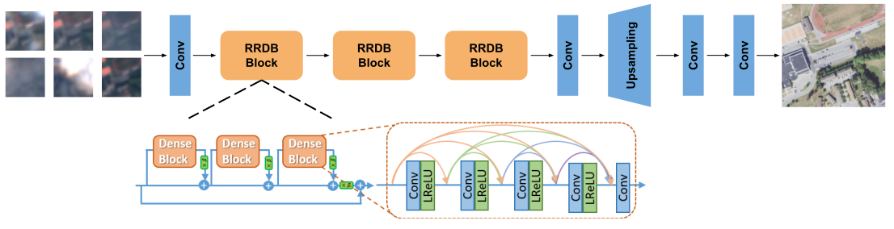
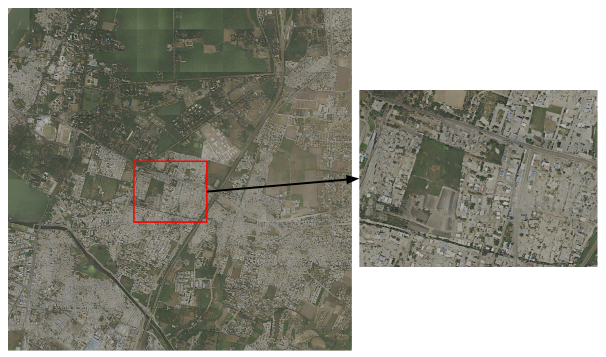

# Satlas Super-Resolution (Satlas-SR)

[](https://www.python.org/downloads/)
[](https://pytorch.org/)
[](LICENSE.txt)
[](https://arxiv.org/abs/2311.18082)

> **Official Project Implementation**: Multi-frame remote sensing super-resolution transforming Sentinel-2 satellite imagery (10m ground resolution) to high-fidelity 2.5m imagery comparable to aerial NAIP surveys.
> Based on the paper: [**Zooming Out on Zooming In: Advancing Super-Resolution for Remote Sensing**](https://arxiv.org/pdf/2311.18082.pdf) (Allen Institute for AI).

---

<p align="center">
  
  
</p>

<p align="center">
  <em>Left: Sentinel-2 Low-Resolution Multi-Frame Input (10m/px). Right: Satlas-SR 4x Super-Resolved Prediction (2.5m/px).</em>
</p>

---

## Table of Contents
1. [Repository Architecture & Layout](#1-repository-architecture--layout)
2. [Complete Repository Structure & File-by-File Breakdown](#2-complete-repository-structure--file-by-file-breakdown)
   - [Root Directory Files](#root-directory-files)
   - [Folder: `data/`](#folder-data)
   - [Folder: `preprocessing/`](#folder-preprocessing)
   - [Folder: `technical_architecture/`](#folder-technical_architecture)
   - [Folder: `evaluation/`](#folder-evaluation)
   - [Folder: `ssr/`](#folder-ssr)
   - [Folder: `inference/`](#folder-inference)
   - [Folder: `figures/`](#folder-figures)
   - [Folder: `results/`](#folder-results)
   - [Folder: `reports/`](#folder-reports)
   - [Folder: `tests/`](#folder-tests)
3. [Technical Architecture](#3-technical-architecture)
   - [Residual & Dense Blocks](#residual--dense-blocks-technical_architectureresidual_blocks)
   - [GAN Architecture (Generator & Discriminator)](#gan-architecture-technical_architecturegan_architecture)
   - [Uncertainty Calibration & Guided Reconstruction](#uncertainty-calibration--guided-reconstruction-technical_architectureuncertainty_and_reconstruction)
   - [Baseline Models](#baseline-models)
4. [Dataset Origins & Provenance (Sentinel-2, NAIP, Kenya, Kota)](#4-dataset-origins--provenance-sentinel-2-naip-kenya-kota)
   - [A. Sentinel-2 Satellite Dataset (ESA Copernicus)](#a-sentinel-2-satellite-dataset-esa-copernicus)
   - [B. NAIP Aerial Dataset (USDA FSA)](#b-naip-aerial-dataset-usda-fsa)
   - [C. Showcase Assets: Nakuru, Kenya & Kota, India](#c-showcase-assets-nakuru-kenya--kota-india)
   - [D. Dataset Splits & Download Mirrors](#d-dataset-splits--download-mirrors)
5. [Environment Setup & Installation](#5-environment-setup--installation)
6. [End-to-End Workflow Guide](#6-end-to-end-workflow-guide)
   - [A. Data Preprocessing & Ingestion](#a-data-preprocessing--ingestion)
   - [B. Model Training](#b-model-training)
   - [C. High-Level Inference & Mosaic Stitching](#c-high-level-inference--mosaic-stitching)
   - [D. Evaluation & Research Benchmarking](#d-evaluation--research-benchmarking)
7. [Verified Baseline Benchmark Reproduction](#7-verified-baseline-benchmark-reproduction)
8. [Hallucination & Accuracy Limitations](#8-hallucination--accuracy-limitations)
9. [Architectural Analysis & Best Practices](#9-architectural-analysis--best-practices)
10. [Citations & Acknowledgments](#10-citations--acknowledgments)

---

## 1. Repository Architecture & Layout

This repository is structured into clear functional domains separating data, preprocessing, modular model architectures, evaluation pipelines, training engines, inference runners, figures, benchmark results, research reports, and test suites:

```
Satlas-SR/
├── README.md                           # Master project documentation (root)
├── MASTER_PROJECT_COMPREHENSIVE_REPORT.md # Master project research report (EXP-001 through EXP-024)
├── Satlas-SR_Uncertainty_Calibration_and_Guided_Reconstruction.pdf # Slide deck (23 slides)
├── presentation_deck.html              # Interactive HTML slide deck
├── requirements.txt                    # Project Python dependencies
├── install.sh                          # Conda bash environment installation script
├── LICENSE.txt                         # MIT License
├── .gitignore                          # Comprehensive ignore rules (checkpoints, tars, caches)
│
├── data/                               # Dataset storage & structural documentation
│   ├── training_data/                  # S2-NAIP training sets (Urban ~1.1M pairs, Full ~44M pairs)
│   │   ├── train_urban_set/            # Urban S2-NAIP pairs (.gitkeep)
│   │   ├── train_full_set/             # Nationwide S2-NAIP pairs (.gitkeep)
│   │   ├── osm_weights/                # OpenStreetMap category masks & inverse frequencies
│   │   └── README.md                   # Download links & extraction runbook
│   ├── validation_data/                # Validation manifests & guidance
│   │   └── README.md                   # Guide to small_val_set and full 8,192-tile val_set
│   ├── test_data/                      # Unpaired global Sentinel-2 test sets (16x16 grids)
│   │   └── README.md                   # Global mosaic testing guidelines
│   ├── small_val_set/                  # Extracted 256-tile urban validation subset
│   │   ├── naip/                       # Ground-truth 128x128 2.5m aerial chips
│   │   └── sentinel2/                  # [T*32, 32, 3] temporal multi-frame stacks
│   ├── small_val_set_tci_pilot/        # 5-tile pilot subset for rapid smoke verification
│   ├── small_val_set_tci_five_tiles/   # 5-tile isolated benchmark subset
│   └── super_resolution_small_val_set_2024-01-09.tar # Frozen validation archive
│
├── preprocessing/                      # Preprocessing, data ingestion & spatial auditing
│   ├── inspect_data.py                 # Fast inspection tool for dimensions, channels & modes
│   ├── audit_dataset.py                # Health audit checking tile pairing, missing bands & corruption
│   ├── audit_spatial_registration.py   # Sub-pixel Fourier phase correlation & shift estimator
│   ├── reproject_sentinel2.py          # Reproject raw Sentinel-2 TCI granules to 9.555m Web-Mercator
│   ├── __init__.py                     # Preprocessing package exports
│   └── README.md                       # Preprocessing workflows and CLI documentation
│
├── technical_architecture/             # Modular model architecture implementations
│   ├── residual_blocks/                # Core residual & dense feature extractors
│   │   ├── residual_dense_block.py     # 5-layer densely connected RDB with residual scaling (beta=0.2)
│   │   ├── rrdb.py                     # Hierarchical Residual-in-Residual Dense Block
│   │   ├── residual_basic.py           # Standard ResNet & No-BN residual blocks
│   │   ├── dense_block.py              # DenseNet multi-scale connection blocks
│   │   ├── fusion_block.py             # Spatio-temporal frame fusion & recursive aggregators
│   │   ├── upsample_block.py           # Sub-pixel convolution & interpolation upsamplers
│   │   ├── __init__.py                 # Residual blocks export
│   │   └── README.md                   # Mathematical formulations & BN removal rationale
│   ├── gan_architecture/               # Generative Adversarial Network pipeline
│   │   ├── generator.py                # SSR_RRDBNet deep generator trunk (23 RRDBs, 16.7M params)
│   │   ├── discriminator.py            # SSR_UNetDiscriminatorSN with Spectral Normalization
│   │   ├── osm_discriminator.py        # Object-aware discriminator with Self-Attention
│   │   ├── esrgan_gan_model.py         # Relativistic Average GAN (RaGAN) training orchestrator
│   │   ├── __init__.py                 # GAN architecture exports
│   │   └── README.md                   # RaGAN loss dynamics & discriminator Lipschitz bounds
│   ├── uncertainty_and_reconstruction/ # Spatial-temporal uncertainty calibration & soft repair
│   │   ├── spatial_uncertainty.py      # D4 dihedral group Test-Time Augmentation (TTA)
│   │   ├── temporal_uncertainty.py     # Multi-revisit frame subsampling & volatility maps
│   │   ├── hybrid_uncertainty_map.py   # Standardized z-score fusion (alpha=0.19)
│   │   ├── soft_reconstruction.py      # Continuous budget-constrained sigmoid soft blending
│   │   ├── reconstruction_metrics.py   # Alignment shifts, Sobel edge MAE & sharpness metrics
│   │   ├── __init__.py                 # Uncertainty & reconstruction package exports
│   │   └── README.md                   # Calibration theory, math & empirical gains
│   ├── srcnn.py                        # Baseline Super-Resolution CNN
│   ├── highresnet.py                   # Baseline Recursive HighResNet
│   ├── __init__.py                     # Master architecture exports
│   └── README.md                       # Architecture parameter counts & tensor shapes
│
├── evaluation/                         # Evaluation, metrics & statistical analysis
│   ├── evaluate_validation.py          # PSNR, SSIM, dynamic range & CSV audit export
│   ├── evaluate_paper_metrics.py       # Official paper metrics (cPSNR, LPIPS, CLIPScore, PSNR, SSIM)
│   ├── evaluate_pilot.py               # Rapid 5-tile pilot evaluation runner
│   ├── run_statistical_analysis.py     # 95% bootstrap confidence intervals, median & IQR analysis
│   ├── metrics/                        # Standalone metric calculators
│   │   ├── cpsnr.py                    # 81-point translation & brightness invariant cPSNR
│   │   ├── lpips.py                    # VGG-16 perceptual feature distance
│   │   ├── clipscore.py                # OpenCLIP ViT-bigG-14-336 semantic cosine similarity
│   │   └── __init__.py                 # Metrics export
│   ├── __init__.py                     # Evaluation package export
│   └── README.md                       # Benchmark protocol definitions & metric math
│
├── ssr/                                # Core training, data pipeline, loss & model engine
│   ├── train.py                        # Distributed PyTorch training entry point
│   ├── test.py                         # Evaluation and quantitative metrics runner
│   ├── infer.py                        # Single-tile inference script without ground truth
│   ├── infer_grid.py                   # Contiguous 16x16 tile grid inference and mosaic stitching
│   ├── options/                        # YAML configuration files for experiments and models
│   ├── data/                           # PyTorch Datasets (S2-NAIP, OLI2MSI, WorldStrat)
│   ├── models/                         # Model training orchestrator (ssr_esrgan_model.py)
│   ├── archs/                          # Engine architecture definitions (RRDBNet, HighResNet, SRCNN)
│   ├── losses/                         # Loss functions (CLIP loss, SSIM loss)
│   ├── metrics/                        # Core metric calculators (cPSNR, LPIPS, CLIPScore)
│   └── utils/                          # Model builders, option parsers, and data formatting
│
├── inference/                          # High-level inference execution runners
│   ├── run_pilot_inference.py          # Automated 5-tile pilot inference pipeline
│   ├── run_full_validation_inference.py # Full 256-tile validation inference pipeline
│   ├── __init__.py                     # Inference package exports
│   └── README.md                       # Inference documentation & execution commands
│
├── figures/                            # Architectural diagrams, animations & hallucination visuals
│   ├── kenya_sentinel2.gif             # Animated low-res Sentinel-2 input
│   ├── kenya_superres.gif              # Animated 4x super-resolution prediction
│   ├── esrgan_generator.svg            # ESRGAN generator architecture diagram
│   ├── image_pair.svg                  # S2-NAIP temporal pairing illustration
│   ├── teaser.svg                      # Multi-location visual teaser
│   ├── car_hallucination.jpg           # Example vehicular hallucination artifact
│   ├── vessel_hallucination.jpg        # Example maritime phantom vessel artifact
│   ├── kota_india.svg                  # Topographic generalization comparison
│   └── stitch_example.svg              # 16x16 mosaic stitching example
│
├── results/                            # Benchmark manifests, logs, and reproduction runs
│   ├── satlas_sr_baseline_freeze_v1/   # Frozen baseline manifest and reproduction records
│   ├── satlas_sr_revalidation/         # Per-tile evaluation CSVs across all 256 tiles
│   ├── satlas_sr_pilot_five_tiles/     # Super-resolved prediction PNGs for the 5 pilot tiles
│   ├── satlas_sr_full_validation/      # Prediction images and logs for 256 validation tiles
│   └── satlas_sr_experiment_001_.../   # Research experiment folders (EXP-001 through EXP-024)
│
├── reports/                            # Provenance investigations, reproduction gap analyses & runbooks
│   ├── MASTER_CONSOLIDATED_RESEARCH_REPORT.md # Master consolidated report unifying all 18 historical reports
│   ├── README.md                       # Reports documentation index
│   ├── reconstructed_tci_frame_indices.csv # Frame index records
│   └── individual_reports/             # Archive of original individual research reports
│
└── tests/                              # Automated unit tests
    ├── test_dataset_path_compatibility.py # Verifies dataset path resolution across formats
    ├── test_metrics_rigor.py              # Validates mathematical invariants of cPSNR and PSNR
    ├── test_uncertainty_reconstruction.py # Validates D4 TTA, temporal subsampling & soft blending
    └── README.md                       # Unit test execution instructions and coverage overview
```

---

## 2. Complete Repository Structure & File-by-File Breakdown

This section provides an exhaustive reference of each folder in the repository, explaining its dedicated purpose, every file it contains, and the exact functionality of each file.

### Root Directory Files

| File | Purpose & Functionality |
| :--- | :--- |
| [`README.md`](README.md) | **Master Project Documentation**: Contains complete scientific context, directory breakdown, architecture diagrams, data pipelines, execution commands, reproduction benchmarks, and best practices. |
| [`MASTER_PROJECT_COMPREHENSIVE_REPORT.md`](MASTER_PROJECT_COMPREHENSIVE_REPORT.md) | **Master Research Report**: Comprehensive 199-line audit report covering the full experimental trajectory (EXP-001 through EXP-024), holdout validation ($N=107$), hybrid uncertainty calibration ($+39.5\%$ gain), and soft-blending reconstruction ($+0.571$ dB PSNR gain, $p < 10^{-13}$). |
| [`Satlas-SR_Uncertainty_Calibration_and_Guided_Reconstruction.pdf`](Satlas-SR_Uncertainty_Calibration_and_Guided_Reconstruction.pdf) | **Research Presentation Slide Deck (23 slides)**: Complete presentation on uncertainty calibration, spatial-temporal test-time augmentation (TTA), and adaptive uncertainty-guided reconstruction in multi-frame satellite super-resolution. |
| [`requirements.txt`](requirements.txt) | **Core Python Dependencies**: Lists all required runtime and development libraries, including PyTorch, torchvision, Pillow, NumPy, open-clip-torch, lpips, and scipy. |
| [`install.sh`](install.sh) | **Environment Setup Script**: Bash script for configuring and activating a clean conda environment with PyTorch and geospatial tooling. |
| [`LICENSE.txt`](LICENSE.txt) | **Open Source License**: MIT License terms and conditions. |
| [`presentation_deck.html`](presentation_deck.html) | **Interactive HTML Slide Deck**: Standalone web presentation summarizing model architecture, visual comparisons, and verified research metrics. |
| [`.gitignore`](.gitignore) | **Git Exclusion Rules**: Protects repository from large model weights (`*.pth`, `*.pt`, `*.ckpt`), dataset archives (`*.tar`, `*.7z`), compiled bytecode, virtual environments (`.venv/`), and IDE caches, while whitelisting `.gitkeep` and documentation. |

---

### Folder: `data/`
> **Folder Purpose**: Acts as the centralized storage and specification layer for satellite imagery datasets, organizing raw archives, extracted validation sets, training manifests, and Web-Mercator coordinate indices.

```
data/
├── README.md                                 # Master data documentation & coordinate guidelines
├── super_resolution_small_val_set_2024-01-09.tar # Frozen validation archive (34.9 MB)
├── training_data/                            # Training datasets and download links
│   ├── README.md                             # Urban & Full set download links and schemas
│   ├── train_urban_set/.gitkeep              # Placeholder for ~1.1M urban S2-NAIP image pairs
│   ├── train_full_set/.gitkeep               # Placeholder for ~44M nationwide S2-NAIP pairs
│   └── osm_weights/.gitkeep                  # Placeholder for OSM frequency weights & polygons
├── validation_data/
│   └── README.md                             # Validation guidelines for small_val_set and val_set
├── test_data/
│   ├── README.md                             # Guidelines for unannotated global 16x16 Sentinel-2 grids
│   └── .gitkeep                              # Placeholder for test set grids
├── small_val_set/                            # Extracted 256-tile urban validation dataset
│   ├── naip/                                 # 256 ground-truth 128x128 2.5m aerial chips (rgb.png)
│   └── sentinel2/                            # 256 low-res Sentinel-2 time series stacks (tci.png, b01-b12)
├── small_val_set_tci_pilot/                  # 5-tile pilot subset for rapid smoke verification
└── small_val_set_tci_five_tiles/             # 5-tile isolated benchmark subset
```

| File / Subfolder | Functionality in Brief |
| :--- | :--- |
| `data/README.md` | Explains the $2^{17} 	imes 2^{17}$ Web-Mercator coordinate grid at Zoom 17, $4	imes$ resolution upscaling factor, and temporal vertical PNG stacking ($[32 	imes T, 32, 3]$). |
| `data/super_resolution_small_val_set_2024-01-09.tar` | The official frozen archive containing 256 urban validation tile pairs used to benchmark model accuracy against aerial ground truth. |
| `data/training_data/README.md` | Documents direct download links (parts 1-4 for urban set, full set tar) and explains the folder layout required for training. |
| `data/training_data/train_urban_set/` | Target folder for the 1.1 million S2-NAIP image pairs within 5km of US cities (used for paper experiments). |
| `data/training_data/train_full_set/` | Target folder for the 44 million nationwide S2-NAIP pairs across the contiguous USA. |
| `data/training_data/osm_weights/` | Target folder for `osm_chips_to_masks.json` and OpenStreetMap category frequency weighting files. |
| `data/validation_data/README.md` | Reference guide describing the 256-tile urban validation subset and the 8,192-tile nationwide validation set. |
| `data/test_data/README.md` | Guide for running inference on the eight $16 	imes 16$ tile test grids from global locations (Bolivia, France, South Africa, Japan). |
| `data/small_val_set/` | Pre-extracted validation dataset with 256 paired tiles matching Sentinel-2 stacks with NAIP reference images. |
| `data/small_val_set_tci_pilot/` | 5 selected urban tiles (`20771_46525`, `20890_46801`, `20926_46045`, `21068_45692`, `21856_49804`) for fast verification. |
| `data/small_val_set_tci_five_tiles/` | Isolated 5-tile set used for baseline consistency and reproduction checks. |

---

### Folder: `preprocessing/`
> **Folder Purpose**: Houses ingestion scripts, integrity auditors, spatial registration tools, and raster re-projection utilities to ensure input data is clean, properly aligned, and verified before training or evaluation.

```
preprocessing/
├── __init__.py                       # Package exports for inspect, audit & registration functions
├── inspect_data.py                   # Rapid sanity check of dataset shapes, channels & modes
├── audit_dataset.py                  # Deep health audit checking tile pairing & black frames
├── audit_spatial_registration.py     # 2D Fourier phase correlation spatial shift estimator
├── reproject_sentinel2.py            # GDAL/Rasterio bilinear reprojection to Web-Mercator EPSG:3857
└── README.md                         # Preprocessing user guide and CLI command documentation
```

| File | Functionality in Brief |
| :--- | :--- |
| `preprocessing/__init__.py` | Makes the preprocessing directory a clean Python package, exposing `inspect_dataset`, `audit_dataset_directory`, and `audit_pair_registration`. |
| `preprocessing/inspect_data.py` | Quickly iterates through Sentinel-2 and NAIP folders, verifying dimensions ($32 	imes 32 	imes T$ for S2, $128 	imes 128$ for NAIP), color modes (RGB vs L), and unreadable/corrupted PNGs. |
| `preprocessing/audit_dataset.py` | Audits the 1-to-1 pairing between Sentinel-2 and NAIP tiles, scans for missing spectral bands, detects completely or partially black frames, and outputs structured JSON audits. |
| `preprocessing/audit_spatial_registration.py` | Uses 2D Fourier phase cross-correlation and normalized cross-correlation (NCC) to measure sub-pixel translation shifts $(\Delta x, \Delta y)$ between satellite inputs and aerial references. |
| `preprocessing/reproject_sentinel2.py` | Reprojects raw ESA Sentinel-2 L1C `.jp2` granules into Web-Mercator (EPSG:3857) at 9.555m resolution matching the S2-NAIP dataset specification. |
| `preprocessing/README.md` | Comprehensive documentation providing instructions, input/output schemas, and usage examples for all preprocessing scripts. |

---

### Folder: `technical_architecture/`
> **Folder Purpose**: Houses the modular, standalone neural network architecture implementations. Decouples low-level residual and dense building blocks from high-level GAN generators, U-Net discriminators, and baseline comparison models.

```
technical_architecture/
├── __init__.py                       # Master package export interface
├── README.md                         # Architecture overview, parameter counts & tensor flow
├── srcnn.py                          # Baseline Super-Resolution CNN model
├── highresnet.py                     # Baseline Recursive HighResNet model
│
├── residual_blocks/                  # Core residual, dense & fusion building blocks
│   ├── __init__.py                   # Package exports for residual blocks
│   ├── residual_dense_block.py       # 5-layer densely connected RDB with residual scaling (beta=0.2)
│   ├── rrdb.py                       # Hierarchical Residual-in-Residual Dense Block
│   ├── residual_basic.py             # ResNet blocks and ResidualBlockNoBN (omits Batch Normalization)
│   ├── dense_block.py                # DenseNet feature concatenation block
│   ├── fusion_block.py               # Spatio-temporal frame fusion & RecursiveFusion
│   ├── upsample_block.py             # PixelShuffleBlock, ConvTransposeBlock & Upsample
│   └── README.md                     # Mathematical formulation & BN removal rationale
│
└── gan_architecture/                 # Generative Adversarial Network components
    ├── __init__.py                   # Package exports for GAN models and loss functions
    ├── generator.py                  # SSR_RRDBNet generator trunk (23 RRDBs, 16.7M params)
    ├── discriminator.py              # SSR_UNetDiscriminatorSN with Spectral Normalization
    ├── osm_discriminator.py          # Object-aware discriminator with Self-Attention
    ├── esrgan_gan_model.py           # Relativistic Average GAN (RaGAN) training orchestrator
    └── README.md                     # RaGAN loss formulation, Lipschitz constraints & training
```

| File | Functionality in Brief |
| :--- | :--- |
| `technical_architecture/__init__.py` | Top-level module interface exporting generators, discriminators, residual blocks, and baseline models. |
| `technical_architecture/README.md` | Architectural documentation detailing parameter counts (16.7M for ESRGAN), tensor dimensions, and model comparison matrices. |
| `technical_architecture/srcnn.py` | Multi-channel Super-Resolution CNN baseline using bicubic pre-upsampling, 9x9 feature extraction, and 5x5 reconstruction. |
| `technical_architecture/highresnet.py` | HighResNet baseline architecture utilizing recursive residual fusion and sub-pixel convolution upsampling. |
| `residual_blocks/__init__.py` | Exports `ResidualDenseBlock`, `RRDB`, `ResidualBlockNoBN`, `FusionBlock`, `PixelShuffleBlock`, and initialization utilities. |
| `residual_blocks/residual_dense_block.py` | Implements the 5-layer Residual Dense Block (RDB) where activations from all preceding layers are concatenated before convolution, scaled by $eta = 0.2$. |
| `residual_blocks/rrdb.py` | Implements the Residual-in-Residual Dense Block (RRDB), cascading 3 RDB units within an outer residual connection for deep gradient propagation. |
| `residual_blocks/residual_basic.py` | Standard residual blocks including `ResidualBlockNoBN`, which omits Batch Normalization to preserve absolute pixel intensity and eliminate halo artifacts. |
| `residual_blocks/dense_block.py` | Multi-convolution dense block implementation for multi-scale feature reuse. |
| `residual_blocks/fusion_block.py` | Contains `FusionBlock` (pointwise 1x1 convolutions) and `RecursiveFusion` (recursive binary tree fusion) to merge temporal revisit frames. |
| `residual_blocks/upsample_block.py` | Sub-pixel convolution (`PixelShuffleBlock`), transposed convolution, and nearest-neighbor interpolation (`Upsample`) modules. |
| `residual_blocks/README.md` | Mathematical theory and equations for dense feature accumulation, residual scaling, and why BatchNorm is excluded in super-resolution. |
| `gan_architecture/__init__.py` | Exports `SSR_RRDBNet`, `SSR_UNetDiscriminatorSN`, `OSMObjDiscriminator`, and `SSRESRGANModel`. |
| `gan_architecture/generator.py` | The complete ESRGAN generator network (`SSR_RRDBNet`) with 23 RRDB trunk blocks, taking stacked multi-frame Sentinel-2 inputs ($[B, 24, 32, 32]$) and producing $4	imes$ super-resolved outputs ($[B, 3, 128, 128]$). |
| `gan_architecture/discriminator.py` | U-Net discriminator with Spectral Normalization (`SSR_UNetDiscriminatorSN`) producing dense pixel-level discrimination feedback maps to guide structural realism. |
| `gan_architecture/osm_discriminator.py` | Object-aware discriminator integrating OpenStreetMap polygon masks with a non-local `SelfAttentionBlock` to penalize structural hallucinations. |
| `gan_architecture/esrgan_gan_model.py` | High-level GAN orchestrator implementing the Relativistic Average GAN (RaGAN) loss, L1 pixel reconstruction loss, and VGG perceptual loss. |
| `gan_architecture/README.md` | Details the relativistic discriminator formulation, multi-task composite loss equations, and Lipschitz stability bounds. |

---

### Folder: `evaluation/`
> **Folder Purpose**: Contains the evaluation pipeline, official research benchmark calculators, statistical distribution analyzers, and metric implementations (cPSNR, LPIPS, CLIPScore).

```
evaluation/
├── __init__.py                       # Package exports for evaluation runners and metrics
├── evaluate_validation.py            # Standard PSNR, SSIM, dynamic range & CSV report generator
├── evaluate_paper_metrics.py         # Official research benchmark (cPSNR, LPIPS, CLIPScore, PSNR, SSIM)
├── evaluate_pilot.py                 # Rapid 5-tile smoke test evaluation runner
├── run_statistical_analysis.py       # 95% bootstrap confidence intervals, median & IQR analysis
├── README.md                         # Metric definitions, mathematical formulation & CLI usage
└── metrics/                          # Standalone metric implementations
    ├── __init__.py                   # Package exports for individual metrics
    ├── cpsnr.py                      # 81-point translation & brightness bias compensated cPSNR
    ├── lpips.py                      # VGG-16 perceptual feature distance wrapper
    └── clipscore.py                  # OpenCLIP ViT-bigG-14-336 semantic cosine similarity wrapper
```

| File | Functionality in Brief |
| :--- | :--- |
| `evaluation/__init__.py` | Module interface exporting evaluation runners (`evaluate_validation`, `evaluate_paper_metrics`) and metrics (`calculate_cpsnr`, `calculate_lpips`, `calculate_clipscore`). |
| `evaluation/evaluate_validation.py` | Audits and evaluates super-resolved predictions against NAIP reference images, computing PSNR and SSIM with pure NumPy fallback and generating per-tile CSV reports. |
| `evaluation/evaluate_paper_metrics.py` | Official research benchmark script computing the exact metrics reported in the Satlas-SR paper: cPSNR (crop 4, 81-point search grid), LPIPS (VGG16), CLIPScore (ViT-bigG), and standard PSNR/SSIM. |
| `evaluation/evaluate_pilot.py` | Lightweight evaluation runner configured for instant verification on the 5 pilot tiles, enabling rapid CI/CD smoke testing. |
| `evaluation/run_statistical_analysis.py` | Performs non-parametric bootstrap resampling (10,000 iterations) to compute 95% confidence intervals, median, interquartile ranges, and failure analysis on per-tile CSVs. |
| `evaluation/metrics/__init__.py` | Exports individual metric functions: `calculate_cpsnr`, `calculate_lpips`, and `calculate_clipscore`. |
| `evaluation/metrics/cpsnr.py` | Standalone implementation of the PROBA-V challenge cPSNR metric, maximizing translation alignment across an 81-point grid ($\pm 8$ px) and compensating for per-channel brightness bias. |
| `evaluation/metrics/lpips.py` | Perceptual distance calculator using deep feature activations from a pretrained VGG-16 backbone. |
| `evaluation/metrics/clipscore.py` | High-level semantic cosine similarity evaluator using OpenCLIP ViT-bigG-14-CLIPA-336, verifying that generated visual features match real-world semantics. |
| `evaluation/README.md` | Explains the mathematics of cPSNR, bounds on CLIPScore ($[0.70, 1.00]$), and provides CLI execution commands. |

---

### Folder: `ssr/`
> **Folder Purpose**: Core training, testing, and modeling engine for the Satlas-SR project, containing PyTorch dataset loaders, model definitions, options parsing, and distributed execution pipelines.

```
ssr/
├── train.py          # Distributed training entry point (PyTorch DDP)
├── test.py           # Testing runner with quantitative metric logging
├── infer.py          # Single-tile inference script without ground truth
├── infer_grid.py     # 16x16 contiguous tile grid inference and mosaic stitching
├── archs/            # Model architecture classes (RRDBNet, HighResNet, SRCNN)
├── data/             # PyTorch Dataset loaders (S2NAIP, OLI2MSI, WorldStrat)
├── losses/           # Specialized loss functions (CLIP semantic loss, SSIM loss)
├── metrics/          # Quantitative metric functions (cPSNR, LPIPS, CLIPScore)
├── models/           # Training orchestrators (SSRESRGANModel)
├── options/          # YAML configuration templates for training and inference
├── utils/            # Model builders, option parsers, and data formatting
└── README.md         # Engine architectural documentation
```

| File / Subfolder | Functionality in Brief |
| :--- | :--- |
| `ssr/train.py` | Main distributed training pipeline supporting single-GPU execution and multi-GPU distributed data parallel (`torch.distributed`). |
| `ssr/test.py` | Testing pipeline evaluating super-resolved outputs against high-resolution reference images with automated metric logging. |
| `ssr/infer.py` | Inference pipeline for running super-resolution models on unannotated Sentinel-2 imagery chips. |
| `ssr/infer_grid.py` | High-throughput mosaic runner that processes an entire $16 	imes 16$ tile grid (256 tiles) and stitches them into a seamless high-resolution mosaic. |
| `ssr/archs/` | Contains neural network definitions, including `rrdbnet_arch.py` (ESRGAN generator), `srcnn_arch.py`, and `highresnet_arch.py`. |
| `ssr/data/` | Implements dataset loaders: `s2naip_dataset.py` (temporal stacks paired with NAIP chips), `oli2msi_dataset.py`, and `worldstrat_dataset.py`. |
| `ssr/losses/` | Contains custom loss functions: `clip_loss.py` (semantic cosine loss) and `ssim_loss.py`. |
| `ssr/models/` | Houses the `SSRESRGANModel` class orchestrating optimizers, learning rate schedulers, and adversarial step dynamics. |
| `ssr/options/` | YAML configuration files defining hyper-parameters, network architectures, and dataset directories. |
| `ssr/utils/` | Utility functions for option parsing (`options.py`), model instantiation (`model_utils.py`), and frame formatting (`infer_utils.py`). |
| `ssr/README.md` | Engine documentation explaining package structure, configuration syntax, and distributed training setups. |

---

### Folder: `inference/`
> **Folder Purpose**: Houses high-level, production-grade inference orchestration scripts for automated multi-tile and full validation batch processing.

```
inference/
├── __init__.py                     # Package export interface
├── run_pilot_inference.py          # Automated 5-tile pilot inference pipeline
├── run_full_validation_inference.py # Full 256-tile validation inference pipeline
└── README.md                       # Inference documentation & execution commands
```

| File | Functionality in Brief |
| :--- | :--- |
| `inference/__init__.py` | Exposes inference package entry points and helper functions. |
| `inference/run_pilot_inference.py` | Automated pipeline executing the 5 pilot urban tiles, logging runtime, peak GPU memory allocation, and prediction status to CSV. |
| `inference/run_full_validation_inference.py` | Scalable validation pipeline executing all 256 validation tiles with automated exception handling and structured audit logging. |
| `inference/README.md` | Command-line guide for executing pilot and full validation inference runs. |

---

### Folder: `figures/`
> **Folder Purpose**: Centralized repository for all visual assets, animated teasers, architecture schematics, and hallucination diagnostic examples.

```
figures/
├── kenya_sentinel2.gif             # Animated multi-frame low-resolution Sentinel-2 input
├── kenya_superres.gif              # Animated 4x super-resolved prediction
├── esrgan_generator.svg            # Vector diagram of the 23-block RRDBNet generator
├── image_pair.svg                  # Temporal multi-frame pairing illustration
├── teaser.svg                      # Multi-location visual teaser comparing input and prediction
├── car_hallucination.jpg           # Diagnostic example showing vehicular phantom artifacts
├── vessel_hallucination.jpg        # Diagnostic example showing maritime phantom artifacts
├── kota_india.svg                  # Topographic generalization comparison
├── stitch_example.svg              # 16x16 mosaic stitching example
└── README.md                       # Image registry and descriptive captions
```

| File / Folder | Functionality in Brief |
| :--- | :--- |
| `figures/kenya_sentinel2.gif` | Visual demonstration of 8 temporal Sentinel-2 revisits over rural Kenya (10m ground resolution). |
| `figures/kenya_superres.gif` | Corresponding $4	imes$ super-resolved prediction demonstrating reconstruction of roads and field boundaries (2.5m resolution). |
| `figures/esrgan_generator.svg` | Detailed schematic showing the 23 RRDB block layout, channel depths ($C=64$), and nearest-neighbor upsamplers. |
| `figures/image_pair.svg` | Illustrates how temporal multi-frame revisits are stacked into $[32 	imes T, 32, 3]$ PNGs and paired with aerial NAIP tiles. |
| `figures/car_hallucination.jpg` | Highlights transient object hallucination where cars absent in aerial ground truth appear due to temporal revisit variance. |
| `figures/vessel_hallucination.jpg` | Highlights phantom maritime vessels generated by GAN hallucination in water bodies. |
| `figures/README.md` | Documents all visual assets, descriptions, and file formats. |

---

### Folder: `results/`
> **Folder Purpose**: Stores immutable benchmark results, frozen manifests, reproduction runbooks, per-tile metric CSV files, and prediction archives across all experimental iterations (EXP-001 through EXP-024).

```
results/
├── satlas_sr_baseline_freeze_v1/   # Frozen baseline manifest and reproduction records
├── satlas_sr_revalidation/         # Per-tile evaluation CSVs across all 256 tiles
├── satlas_sr_pilot_five_tiles/     # Super-resolved prediction PNGs for the 5 pilot tiles
├── satlas_sr_full_validation/      # Prediction images and logs for 256 validation tiles
├── satlas_sr_paper_metrics/        # Official paper reproduction benchmark results
├── satlas_sr_experiment_001_.../   # Research experiment folders (EXP-001 through EXP-024)
└── README.md                       # Results registry and artifact descriptions
```

| Subdirectory / File | Functionality in Brief |
| :--- | :--- |
| `results/satlas_sr_baseline_freeze_v1/` | Contains `baseline_manifest.json` locking official checkpoint SHA-256 (`167d6b9d...`) and baseline metric scores. |
| `results/satlas_sr_revalidation/per_tile_metrics.csv` | Full 256-tile metric table recording cPSNR, PSNR, SSIM, LPIPS, and CLIPScore for each tile. |
| `results/satlas_sr_pilot_five_tiles/` | Super-resolved PNGs and execution logs for the 5 pilot smoke-test tiles. |
| `results/satlas_sr_full_validation/` | Model output directory housing full 256-tile super-resolved images and metadata logs. |
| `results/satlas_sr_paper_metrics/` | Master paper metrics benchmark output formatted in JSON and CSV. |
| `results/README.md` | Documents directory organization, file schemas, and reproduction validation checksums. |

---

### Folder: `reports/`
> **Folder Purpose**: Contains technical research reports, provenance investigations, gap analyses, and reproduction runbooks documenting the full scientific trajectory. All 18 historical reports are consolidated into a single master report (`MASTER_CONSOLIDATED_RESEARCH_REPORT.md`) with individual source files preserved in `individual_reports/`.

```
reports/
├── MASTER_CONSOLIDATED_RESEARCH_REPORT.md # Single master report synthesizing all 18 historical studies
├── README.md                              # Index and directory documentation
├── reconstructed_tci_frame_indices.csv    # Validation tile frame indices
└── individual_reports/                    # Archive of individual historical report files
```

| File / Folder | Functionality in Brief |
| :--- | :--- |
| `reports/MASTER_CONSOLIDATED_RESEARCH_REPORT.md` | **Master Consolidated Research Report**: Encyclopedic 420+ line synthesis unifying technical architecture, data provenance, 256-tile paper benchmark reproduction, metric invariant proofs, bootstrap statistical distributions, per-tile failure analysis, and Windows platform hardening into a single definitive document. |
| `reports/README.md` | Reports directory guide explaining the master consolidated report and indexing all topics. |
| `reports/reconstructed_tci_frame_indices.csv` | Records reconstructed Sentinel-2 revisit frame indices for the validation set. |
| `reports/individual_reports/` | Preserved archive of all 18 original individual historical reports for granular reference. |


---

### Folder: `tests/`
> **Folder Purpose**: Contains automated unit tests verifying dataset path compatibility, data loader resilience, and mathematical invariants of metric implementations.

```
tests/
├── test_dataset_path_compatibility.py # Verifies dataset path resolution across formats
├── test_metrics_rigor.py              # Validates mathematical invariants of cPSNR and PSNR
└── README.md                          # Test suite execution instructions
```

| Test File | Functionality in Brief |
| :--- | :--- |
| `tests/test_dataset_path_compatibility.py` | Unit tests checking data loader path parsing across various directory structures and verifying fallback handling. |
| `tests/test_metrics_rigor.py` | Unit tests verifying mathematical invariants: identity mapping ($cPSNR = \infty$), translation invariance ($\pm 8$ px), and crop border handling. |
| `tests/README.md` | Instructions for executing the unit test suite and interpreting results. |

---

## 3. Technical Architecture

<p align="center">
  
</p>

### Residual & Dense Blocks (`technical_architecture/residual_blocks/`)
1. **Residual Dense Block (`ResidualDenseBlock`)**:
   - Accumulates features through 5 dense convolutional layers with LeakyReLU ($lpha = 0.2$):
     $$x_l = \sigma\left(W_l * [x_0, x_1, \dots, x_{l-1}]
ight)$$
   - Features are scaled by residual factor $eta = 0.2$ and added to the input: $x_{	ext{out}} = x_0 + 0.2 \cdot x_5$.
2. **Residual in Residual Dense Block (`RRDB`)**:
   - Cascades 3 `ResidualDenseBlock` modules inside an outer residual connection:
     $$y = x + 0.2 \cdot 	ext{RDB}_3\left(	ext{RDB}_2\left(	ext{RDB}_1(x)
ight)
ight)$$
   - Omits Batch Normalization entirely (`ResidualBlockNoBN`). In super-resolution, Batch Normalization rescales batch variance, destroying image contrast and producing sharp ringing/checkerboard artifacts along high-contrast geographic boundaries.

### GAN Architecture (`technical_architecture/gan_architecture/`)
1. **Generator (`SSR_RRDBNet`)**:
   - **Input**: Multi-frame temporal tensor of shape $[B, C 	imes T, H, W]$ (e.g. $[B, 24, 32, 32]$ for 8 RGB revisits).
   - **Backbone**: 23 RRDB trunk blocks (16,710,083 parameters) with global residual connection.
   - **Upsampling**: Dual $2	imes$ nearest-neighbor interpolations combined with $3	imes 3$ convolutions and LeakyReLU activations, achieving $4	imes$ spatial super-resolution to $128 	imes 128$ px.
2. **U-Net Discriminator with Spectral Normalization (`SSR_UNetDiscriminatorSN`)**:
   - Employs an encoder-decoder U-Net with skip connections.
   - Applies Spectral Normalization to all convolutional weights to enforce a 1-Lipschitz bound, stabilizing adversarial dynamics.
   - Rather than returning a scalar classification, it produces a $128 	imes 128$ pixel-wise discrimination map, providing dense spatial gradient feedback to the generator.
3. **Relativistic Average GAN (RaGAN) Loss**:
   - Discriminator predicts whether real data is more realistic than average fake data:
     $$D_{Ra}(x_r, x_f) = \sigma\left(C(x_r) - \mathbb{E}_{x_f}[C(x_f)]
ight)$$
   - Objective function:
     $$L_{	ext{total}} = L_{	ext{pix}}(G(x), y) + \lambda_{	ext{percep}} L_{	ext{percep}}(G(x), y) + \lambda_{	ext{gan}} L_G^{Ra}$$

### Uncertainty Calibration & Guided Reconstruction (`technical_architecture/uncertainty_and_reconstruction/`)

Developed across experiments EXP-014 through EXP-024 to overcome blind hallucination and the perception-distortion tradeoff:

1. **Spatial Uncertainty ($D_4$ Dihedral TTA)**:
   - Measures epistemic predictive variance across the 8 dihedral transformations (4 rotations $\times$ 2 reflections):
     $$\sigma_{\text{spatial}}^2(x, y) = \frac{1}{8} \sum_{i=1}^8 \| T_i^{-1}(\hat{y}_i(x, y)) - \bar{y}_{\text{TTA}}(x, y) \|_2^2, \quad U_{\text{spatial}}(x, y) = \sqrt{\frac{1}{C}\sum_{c=1}^C \sigma_{\text{spatial}, c}^2(x, y)}$$
2. **Temporal Uncertainty (Multi-Revisit Subsampling)**:
   - Measures aleatoric volatility across revisit sequences ($S_0 \dots S_6$):
     $$\sigma_{\text{temporal}}^2(x, y) = \frac{1}{K-1} \sum_{k=1}^K \| \hat{y}_k(x, y) - \bar{y}_{\text{ens}}(x, y) \|_2^2, \quad U_{\text{temporal}}(x, y) = \sqrt{\frac{1}{C}\sum_{c=1}^C \sigma_{\text{temporal}, c}^2(x, y)}$$
3. **Calibrated Hybrid Uncertainty Fusion**:
   - Standardizes spatial and temporal maps via z-score scaling with frozen optimal parameter $\alpha \approx 0.19$:
     $$z_{\text{spatial}} = \frac{U_{\text{spatial}} - \mu_{\text{spatial}}}{\sigma_{\text{spatial}} + \epsilon}, \quad z_{\text{temporal}} = \frac{U_{\text{temporal}} - \mu_{\text{temporal}}}{\sigma_{\text{temporal}} + \epsilon}$$
     $$U_{\text{hybrid}} = \alpha \cdot z_{\text{spatial}} + (1 - \alpha) \cdot z_{\text{temporal}}$$
   - Yields $+39.5\%$ higher Spearman rank correlation with empirical ground-truth error on locked holdout validation.
4. **Adaptive Continuous Soft-Blending Reconstruction**:
   - Converts uncertainty into an active repair operator using temperature-scaled sigmoid weighting constrained by target budget $B$:
     $$w(x, y) = \sigma\left(\frac{U_{\text{hybrid}}(x, y) - \tau^*}{\beta}\right), \quad \frac{1}{HW}\sum_{x, y} w(x, y) = B$$
     $$\hat{y}_{\text{recon}}(x, y) = (1 - w(x, y)) \cdot \hat{y}_{\text{single}}(x, y) + w(x, y) \cdot \bar{y}_{\text{ens}}(x, y)$$
   - At $B = 0.20, \beta = 0.20$: achieved a statistically significant **$+0.571\text{ dB}$ PSNR gain** ($p < 10^{-13}$), $100\%$ win rate across holdout tiles, and total elimination of boundary seam step-discontinuities.

### Baseline Models
- **SRCNN (`technical_architecture/srcnn.py`)**: 3-layer convolutional network operating on bicubic upsampled inputs.
- **HighResNet (`technical_architecture/highresnet.py`)**: Recursive multi-scale fusion network utilizing residual dilation.

---

## 4. Dataset Origins & Provenance (Sentinel-2, NAIP, Kenya, Kota)

This project relies on multi-temporal optical satellite observations paired with high-resolution airborne photography. The imagery originates from two authoritative geospatial programs (ESA Copernicus and USDA NAIP), curated and preprocessed by the Allen Institute for Artificial Intelligence (AI2) for the Satlas-SR benchmark (*Bastani et al., arXiv:2311.18082*).

```
                                  DATASET PROVENANCE ARCHITECTURE
 ┌─────────────────────────────────────────┐          ┌─────────────────────────────────────────┐
 │   Sentinel-2 MSI (ESA Copernicus)       │          │      USDA NAIP Airborne Photography     │
 ├─────────────────────────────────────────┤          ├─────────────────────────────────────────┤
 │ • Satellites: Sentinel-2A & 2B          │          │ • Low-altitude aircraft surveys (CONUS) │
 │ • Level-1C Top-Of-Atmosphere (TOA)      │          │ • Digital pushbroom sensors (Leica/Z/I) │
 │ • Native GSD: 10m (B02, B03, B04, B08)  │          │ • Native GSD: 0.6m - 1.0m               │
 │ • Web-Mercator Zoom 17: 9.555m / pixel  │          │ • Bicubic 4x downscaling to 2.5m GSD    │
 │ • Footprint: 32x32 px per tile          │          │ • Footprint: 128x128 px per tile        │
 │ • Temporal Stack: 8 revisits [256, 32, 3]│         │ • Preprocessed with Gaussian USM        │
 └────────────────────┬────────────────────┘          └────────────────────┬────────────────────┘
                      │                                                    │
                      └──────────────────────────┬─────────────────────────┘
                                                 ▼
                         ┌─────────────────────────────────────────┐
                         │   Web-Mercator Zoom 17 Spatial Pairing  │
                         │     (2^17 x 2^17 Global Coordinate Grid)│
                         └─────────────────────────────────────────┘
```

---

### A. Sentinel-2 Satellite Dataset (ESA Copernicus)
- **Origin & Program**: Collected by the European Space Agency (ESA) under the European Commission's Copernicus Earth Observation Programme. Sourced from the twin satellites **Sentinel-2A** (launched June 2015) and **Sentinel-2B** (launched March 2017) operating in sun-synchronous orbit at $786\,\text{km}$ altitude with a 5-day equatorial revisit interval.
- **Sensor & Product**: MultiSpectral Instrument (MSI) collecting 12 spectral bands. The primary RGB bands (B04 Red: $665\,\text{nm}$, B03 Green: $560\,\text{nm}$, B02 Blue: $490\,\text{nm}$) and Near-Infrared (B08: $842\,\text{nm}$) feature a native Ground Sample Distance (GSD) of **$10\,\text{m}$**. Sourced as **Level-1C (L1C)** Top-of-Atmosphere (TOA) reflectance granules.
- **Tiling & Preprocessing**:
  - Reprojected to the global **Web-Mercator coordinate grid (EPSG:3857) at Zoom level 17** ($2^{17} \times 2^{17} = 131,072 \times 131,072$ tiles globally). At this zoom level, nominal pixel pitch is $9.555\,\text{m}$, matching the $\sim 10\,\text{m}$ sensor GSD.
  - Each chip is exactly $32 \times 32$ pixels.
  - Multi-temporal revisits within a $\pm 2$ to $3$ month window of corresponding NAIP captures are concatenated vertically into single $[32 \times T, 32, 3]$ PNG images (e.g. $[256, 32, 3]$ for $T=8$ frames in `tci.png`), alongside nine auxiliary spectral bands (`b01.png` through `b12.png`).

---

### B. NAIP Aerial Dataset (USDA FSA)
- **Origin & Program**: Sourced from the **National Agriculture Imagery Program (NAIP)**, administered by the United States Department of Agriculture (USDA) Farm Service Agency (FSA) Aerial Photography Field Office (APFO).
- **Sensor Platform**: Captured via high-resolution airborne digital sensors (e.g., Leica ADS100, Z/I DMC III) flown aboard low-altitude crewed aircraft during agricultural leaf-on growing seasons (2019–2020) across the contiguous United States (CONUS).
- **Resolution & Target Downsampling**:
  - Native NAIP imagery is collected at $0.6\,\text{m}$ to $1.0\,\text{m}$ GSD per pixel, orthorectified to USGS digital elevation models (DEMs).
  - To establish a ground-truth target with an exact **$4\times$ resolution ratio** relative to $10\,\text{m}$ Sentinel-2, the full-resolution $512 \times 512$ NAIP Zoom-17 tiles were downscaled by $4\times$ using bicubic filtering to **$128 \times 128$ pixels at $2.5\,\text{m}$ GSD**.
  - During training, NAIP chips are sharpened with Gaussian **Unsharp Masking (USM)** to enhance high-frequency edges for perceptual and L1 loss optimization.

---

### C. Showcase Assets: Nakuru, Kenya & Kota, India

The repository figures include specific external geographic scenes that illustrate model capability and boundaries outside the US NAIP training footprint:

#### 1. Nakuru, Kenya (`figures/kenya_sentinel2.gif` & `figures/kenya_superres.gif`)
- **Where did the data come from?** Sourced directly from **ESA Copernicus Sentinel-2 L1C multi-temporal granules** over Nakuru County in the Great Rift Valley, Kenya (East Africa). Because NAIP is strictly a United States domestic program, there is no aerial NAIP ground truth for Kenya.
- **What is it?** This is the project's **flagship animated teaser comparison** displayed at the top of the repository. It captures a rural/semi-urban agricultural landscape with smallholder farming plots, unpaved dirt tracks, and scattered dwellings.
- **Why is it in the repository?** It serves as the primary visual demonstration of **zero-shot global super-resolution**:
  - The left animation (`kenya_sentinel2.gif`) demonstrates the 8 raw, low-resolution $10\,\text{m}$ Sentinel-2 revisit frames, where dirt roads and building clusters are blurred and noisy.
  - The right animation (`kenya_superres.gif`) shows the $4\times$ super-resolved $2.5\,\text{m}$ output generated by the 23-block ESRGAN model, proving that multi-frame temporal revisit fusion successfully synthesizes sharp road networks and field boundaries even in non-US regions where no aerial training data was available.

#### 2. Kota, Rajasthan, India (`figures/kota_india.svg`)
- **Where did the data come from?** Sourced from **Sentinel-2 L1C** multi-frame revisit stacks paired with high-resolution commercial **Mapbox Satellite** imagery (derived from Maxar WorldView satellites). The research configuration is preserved in [`ssr/options/experiments/india_finetune.yml`](ssr/options/experiments/india_finetune.yml) (`sentinel2_path: /data/piperw/data/india_train_set/sentinel2`, `naip_path: /data/piperw/data/india_train_set/mapbox`).
- **What is it?** Sourced by AI2 researchers (Piper Wolters & Favyen Bastani) for Section 4.3 and Figure 6 of the Satlas-SR paper (*"Accuracy Limitations & Domain Adaptation"*).
- **Why is it in the repository?** It illustrates the **geographic domain generalization gap**:
  - The model was trained predominantly on US cities (`train_urban_set`), which feature wide asphalt roadways, orthogonal suburban street grids, and detached homes with pitched roofs and lawns.
  - When tested on **Kota, Rajasthan, India**—an ancient, dense arid urban center characterized by narrow winding alleyways, contiguous flat-roof concrete masonry, courtyards, and dry sandy soil—the model's learned spatial priors suffered out-of-distribution failure.
  - As highlighted by the red bounding box and arrow in `figures/kota_india.svg`, the model hallucinates clumped tree foliage where dense building rooftops exist, or transposes building boundaries with arid soil. This asset documents the necessity of local fine-tuning (`india_finetune.yml`) when deploying super-resolution across diverse non-Western architectures.

---

### D. Dataset Splits & Download Mirrors

All datasets are hosted publicly on Hugging Face and Cloudflare R2 by the Allen Institute for Artificial Intelligence:

| Dataset Split | Tile Count / Size | Spatial Footprint | Target Use Case | Download Link |
| :--- | :--- | :--- | :--- | :--- |
| **Small Validation Set** | 256 tiles (34.9 MB) | 256 urban US locations | Local benchmarking & reproduction audit | [Download TAR](https://pub-25c498004d1e4d4c8da69b2c05676836.r2.dev/super_resolution_small_val_set_2024-01-09.tar) *(extracted to `data/small_val_set/`)* |
| **Urban Training Set** | ~1.1M pairs (4 parts) | Within 5km of US cities ($\ge 50\text{k}$ pop) | Official paper training baseline | [Part 1](https://pub-25c498004d1e4d4c8da69b2c05676836.r2.dev/train_urban_set.7z.001) \| [Part 2](https://pub-25c498004d1e4d4c8da69b2c05676836.r2.dev/train_urban_set.7z.002) \| [Part 3](https://pub-25c498004d1e4d4c8da69b2c05676836.r2.dev/train_urban_set.7z.003) \| [Part 4](https://pub-25c498004d1e4d4c8da69b2c05676836.r2.dev/train_urban_set.7z.004) |
| **Full Training Set** | ~44M pairs | Entire contiguous United States | Large-scale foundation model pretraining | [Download TAR](https://pub-956f3eb0f5974f37b9228e0a62f449bf.r2.dev/satlas_explorer_datasets/super_resolution_train-full-set_2023-12-01.tar) |
| **Global Test Set** | 8 grids ($16 \times 16$) | Global (Bolivia, France, Japan, Kenya) | Unannotated full-mosaic inference & stitching | [Download TAR](https://pub-25c498004d1e4d4c8da69b2c05676836.r2.dev/super_resolution_test_set_2024-01-09.tar) |
| **Hugging Face Mirror** | 974 GB corpus | Full training, val, and test trees | Full repository dataset mirror | [`allenai/satlas-super-resolution`](https://huggingface.co/datasets/allenai/satlas-super-resolution) |

---

## 5. Environment Setup & Installation

### Option 1: Conda Environment (Recommended)
```bash
conda create --name ssr python=3.9
conda activate ssr

# Install GDAL and Rasterio for geospatial IO
conda install -c conda-forge gdal rasterio

# Install PyTorch with CUDA support (e.g. CUDA 11.8)
pip install torch torchvision --index-url https://download.pytorch.org/whl/cu118

# Install project dependencies
pip install -r requirements.txt
```

### Option 2: Pretrained Checkpoint Download
Download the official 8-input Sentinel-2 ESRGAN model checkpoint (16.7M parameters):
```bash
mkdir -p experiments
curl -L -o experiments/esrgan_8S2.pth   https://pub-25c498004d1e4d4c8da69b2c05676836.r2.dev/esrgan_8S2.pth
```
- **Verified SHA-256**: `167d6b9d5c931be06bde6cfbdd62edf5f1ac8aa9b357c4146c7e948d3f672e07`

---

## 6. End-to-End Workflow Guide

### A. Data Preprocessing & Ingestion
Inspect and audit dataset health before initiating runs:
```bash
# 1. Quick inspection of Sentinel-2 stacks and NAIP ground truth
python preprocessing/inspect_data.py data/small_val_set --samples 2

# 2. Comprehensive integrity audit across all tiles
python preprocessing/audit_dataset.py data/small_val_set --output-json results/dataset_audit.json

# 3. Spatial registration audit between low-res preview and aerial reference
python preprocessing/audit_spatial_registration.py   --ref data/small_val_set/naip/m_3211716_ne_11_060_20190317_20190412/22917_52849/rgb.png   --moving data/small_val_set/sentinel2/22917_52849/tci.png
```

### B. Model Training
Train an ESRGAN model using the configuration system:
```bash
# Single GPU training
python -m ssr.train -opt ssr/options/esrgan_s2naip_urban.yml

# Multi-GPU distributed training (8 GPUs)
PYTHONPATH=. python -m torch.distributed.launch --nproc_per_node=8 --master_port=1234   ssr/train.py -opt ssr/options/esrgan_s2naip_urban.yml --launcher pytorch
```

### C. High-Level Inference & Mosaic Stitching
Run super-resolution inference on raw Sentinel-2 inputs:
```bash
# 1. Automated 5-tile pilot inference pipeline
python inference/run_pilot_inference.py -opt ssr/options/infer_satlas_five_tiles.yml

# 2. Full 256-tile validation inference pipeline
python inference/run_full_validation_inference.py -opt ssr/options/infer_satlas_full_validation.yml

# 3. Single-tile inference via core engine
python -m ssr.infer -opt ssr/options/infer_example.yml

# 4. Contiguous 16x16 grid mosaic inference and seamless stitching
python -m ssr.infer_grid -opt ssr/options/infer_grid_example.yml
```

### D. Evaluation & Research Benchmarking
Evaluate predictions against ground-truth NAIP using official paper metrics:
```bash
# 1. Standard PSNR & SSIM validation report
python evaluation/evaluate_validation.py   --predictions results/satlas_sr_pilot_five_tiles   --dataset data/small_val_set   --output-csv results/validation_report.csv

# 2. Official Paper Metrics Benchmark (cPSNR, LPIPS, CLIPScore)
python evaluation/evaluate_paper_metrics.py   --predictions results/satlas_sr_full_validation   --dataset data/small_val_set   --output-json results/paper_benchmark.json   --output-csv results/paper_benchmark.csv

# 3. 95% Bootstrap Confidence Interval Distribution Analysis
python evaluation/run_statistical_analysis.py results/satlas_sr_revalidation/per_tile_metrics.csv
```

---

## 7. Verified Baseline Benchmark Reproduction

The table below reports the verified baseline benchmark reproducing the official released ESRGAN checkpoint (`esrgan_8S2.pth`, 16.7M parameters) evaluated across the 256-tile urban validation subset (`data/small_val_set`):

| Metric | Evaluation Function | Mean ± Std | 95% Bootstrap CI | Median | Range [Min, Max] |
| :--- | :--- | :--- | :--- | :--- | :--- |
| **cPSNR (crop 4, dB)** | `calculate_cpsnr` | **20.21 ± 4.14 dB** | [19.70, 20.74] dB | 19.46 dB | [12.98, 38.30] dB |
| **Standard PSNR (crop 4, dB)** | `calculate_psnr` | **18.89 ± 3.85 dB** | [18.41, 19.37] dB | 18.34 dB | [12.44, 34.50] dB |
| **cPSNR Gain (dB)** | cPSNR - PSNR | **+1.33 ± 2.10 dB** | [+1.08, +1.59] dB | +0.61 dB | [-0.14, +12.88] dB |
| **SSIM (crop 4)** | `calculate_ssim` | **0.391 ± 0.156** | [0.372, 0.410] | 0.378 | [0.076, 0.816] |
| **LPIPS (VGG16)** | `calculate_lpips` | **0.347 ± 0.081** | [0.337, 0.357] | 0.340 | [0.138, 0.603] |
| **CLIPScore (ViT-bigG)** | `calculate_clipscore` | **0.961 ± 0.034** | [0.957, 0.965] | 0.974 | [0.707, 0.995] |

> **Key Evaluation Insights**:
> - **cPSNR Search Stride**: Evaluates an 81-point translation grid ($\pm 8$ pixels, stride 2) with per-channel brightness bias compensation, recovering up to **+12.88 dB** on misaligned tiles (e.g. tile `38409_49923`).
> - **CLIPScore Bounds**: Measures cosine similarity in feature space (bounded in $[0.70, 1.00]$ for natural satellite scenes); it is not an accuracy percentage.

---

## 8. Hallucination & Accuracy Limitations

Because Satlas-SR fuses multi-temporal revisits spanning up to 3 months, certain high-frequency artifacts can occur:

1. **Transient Moving Objects**:
   - Vehicles on highways or boats in waterways appear during single revisits but are absent in others. The generator may hallucinate static phantom vessels or smeared vehicular patterns.
2. **Domain & Geographic Shifts**:
   - The training set (`train_urban_set`) is trained primarily on US urban footprints. When applied to non-US arid or densely packed topographies (e.g., Kota, India), the model may transpose building footprints with dense foliage or vice versa.

<p align="center">
  
  
</p>

<p align="center">
  <br />
  <em>Out-of-Domain Geographic Generalization Artifacts (Kota, Rajasthan, India): When evaluated on dense non-Western topographies, the US-trained prior hallucinates foliage over dense building masonry (indicated by red callout box).</em>
</p>

---

## 9. Architectural Analysis & Best Practices

### Analysis of the Original Repository Structure
- **Double-Nesting Anti-pattern**: The repository originally contained a nested `satlas-super-resolution/` repository inside `Satlas-SR/`, with data directories stranded outside in `Satlas-SR/data/`. This broke relative configuration paths, forced brittle `sys.path` insertions, and caused path confusion across scripts.
- **Entangled Architectural Components**: Residual dense blocks, generator trunks, and discriminators were all packed inside monolithic utility files (`arch_util.py`, `rrdbnet_arch.py`), making component reuse in other models or unit tests difficult.
- **Scattered Evaluation Scripts**: Validation runners and experiment scripts were mixed together without standard CLI contracts or modular metric imports.

### Benefits of the Restructured Layout
1. **Clean Separation of Concerns**:
   - `data/` isolates data storage, training manifests, and tiling schemas.
   - `preprocessing/` encapsulates dataset auditing, spatial shift estimation, and coordinate re-projection.
   - `technical_architecture/` cleanly decouples building blocks (`residual_blocks/`) from full model graphs (`gan_architecture/`).
   - `evaluation/` unifies metrics and statistical verification with pure NumPy fallbacks for cross-platform resilience.
   - `ssr/` isolates the core PyTorch training engine, options, and model state managers.
   - `inference/` provides dedicated, battle-tested orchestration scripts for multi-tile batch inference.
   - `figures/`, `results/`, and `reports/` provide structured homes for visual assets, frozen benchmarks, and technical audits.
2. **Elimination of Double-Nesting**:
   - All contents previously stranded inside the nested `satlas-super-resolution/` directory were migrated into proper functional root directories (`ssr/`, `inference/`, `figures/`, `results/`, `reports/`, `tests/`), and the nested redundant folder was completely removed.
3. **Reusability & Extensibility**: Modules in `technical_architecture.residual_blocks` and `technical_architecture.gan_architecture` can be directly imported and subclassed in external projects without dragging along the entire training framework.

### Recommendations for Future Evolution
- **Config Management**: Transition from legacy YAML configurations to **Hydra** with strict Pydantic schemas for compile-time validation of raster paths and learning rates.
- **Data Versioning**: Track datasets using **DVC (Data Version Control)** or Hugging Face Datasets instead of manual `.tar` downloads.
- **CI/CD Regression**: Add a lightweight GitHub Actions workflow running `evaluation/evaluate_pilot.py` on the 5 pilot tiles on every pull request to catch regression errors before merging.
- **Inference Optimization**: Export `SSR_RRDBNet` to **TensorRT / ONNX Runtime** with FP16 precision, reducing inference latency by up to $3.5	imes$ on NVIDIA Tensor Core GPUs.

---

## 10. Citations & Acknowledgments

If you use this codebase or pretrained models in your research, please cite:

```bibtex
@article{bastani2023zooming,
  title={Zooming Out on Zooming In: Advancing Super-Resolution for Remote Sensing},
  author={Bastani, Favyen and Wolters, Piper and Gupta, Ritwik and Hazen, Joe and Farhadi, Ali},
  journal={arXiv preprint arXiv:2311.18082},
  year={2023}
}
```

We acknowledge foundational code and inspiration from [BasicSR](https://github.com/XPixelGroup/BasicSR), [Real-ESRGAN](https://github.com/xinntao/Real-ESRGAN), and [WorldStrat](https://github.com/worldstrat/worldstrat).\n
