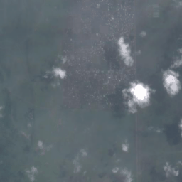
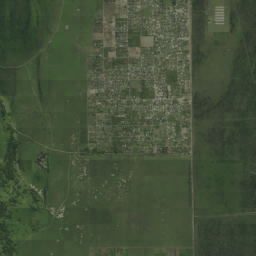
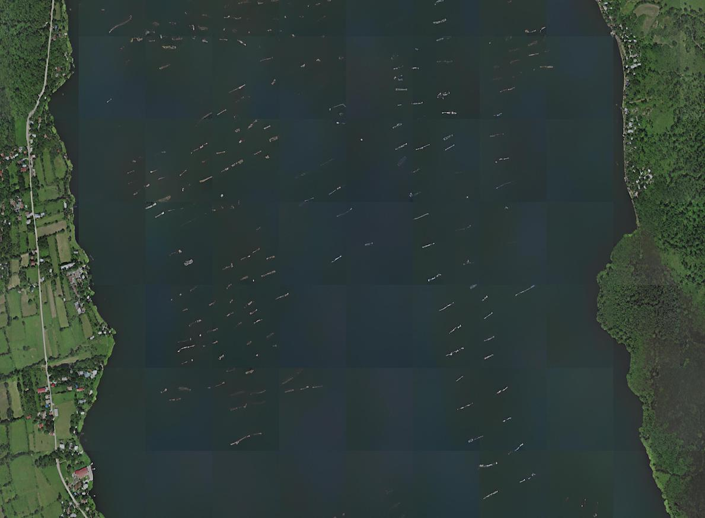
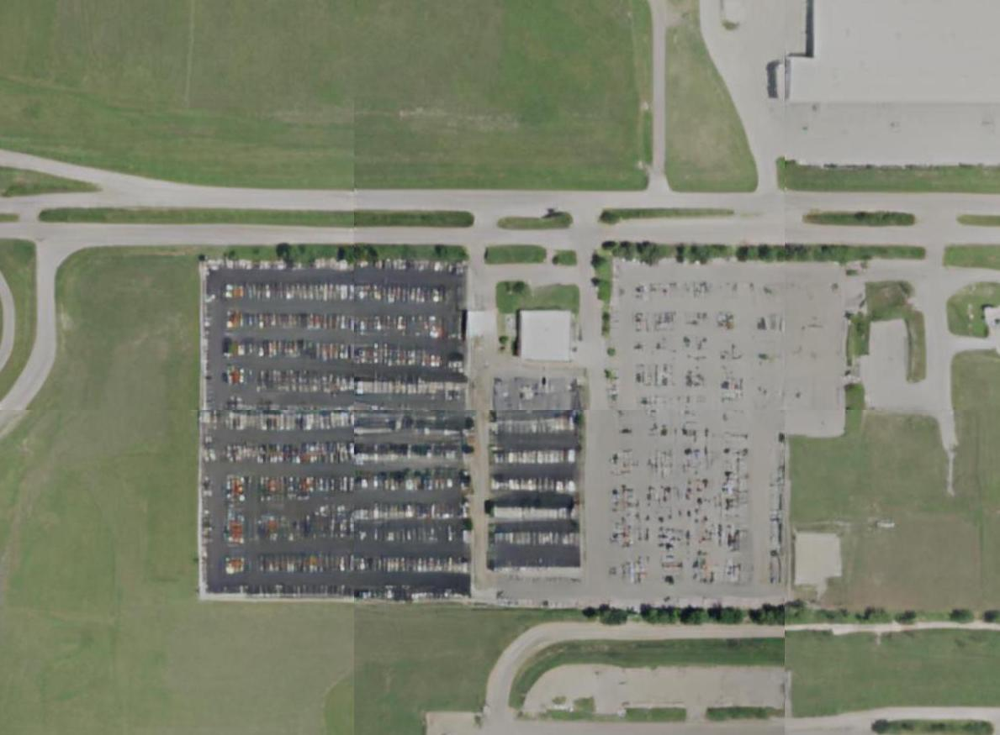

# Satlas Super-Resolution (Satlas-SR)

[](https://www.python.org/downloads/)
[](https://pytorch.org/)
[](LICENSE.txt)
[](https://arxiv.org/abs/2311.18082)

> **Official Project Implementation**: Multi-frame remote sensing super-resolution transforming Sentinel-2 satellite imagery (10m ground resolution) to high-fidelity 2.5m imagery comparable to aerial NAIP surveys.
> Based on the paper: [**Zooming Out on Zooming In: Advancing Super-Resolution for Remote Sensing**](https://arxiv.org/pdf/2311.18082.pdf) (Allen Institute for AI).

---

<p align="center">
  
  
</p>

<p align="center">
  <em>Left: Sentinel-2 Low-Resolution Multi-Frame Input (10m/px). Right: Satlas-SR 4x Super-Resolved Prediction (2.5m/px).</em>
</p>

---

## Table of Contents
1. [Repository Architecture & Layout](#1-repository-architecture--layout)
2. [Complete Repository Structure & File-by-File Breakdown](#2-complete-repository-structure--file-by-file-breakdown)
   - [Root Directory Files](#root-directory-files)
   - [Folder: `data/`](#folder-data)
   - [Folder: `preprocessing/`](#folder-preprocessing)
   - [Folder: `technical_architecture/`](#folder-technical_architecture)
   - [Folder: `evaluation/`](#folder-evaluation)
   - [Folder: `satlas-super-resolution/`](#folder-satlas-super-resolution)
3. [Technical Architecture](#3-technical-architecture)
   - [Residual & Dense Blocks](#residual--dense-blocks)
   - [GAN Architecture (Generator & Discriminator)](#gan-architecture-generator--discriminator)
   - [Baseline Models](#baseline-models)
4. [Data Management & Layout](#4-data-management--layout)
5. [Environment Setup & Installation](#5-environment-setup--installation)
6. [End-to-End Workflow Guide](#6-end-to-end-workflow-guide)
   - [A. Data Preprocessing & Ingestion](#a-data-preprocessing--ingestion)
   - [B. Model Training](#b-model-training)
   - [C. Inference & Large-Scale Grid Stitching](#c-inference--large-scale-grid-stitching)
   - [D. Evaluation & Research Benchmarking](#d-evaluation--research-benchmarking)
7. [Verified Baseline Benchmark Reproduction](#7-verified-baseline-benchmark-reproduction)
8. [Hallucination & Accuracy Limitations](#8-hallucination--accuracy-limitations)
9. [Architectural Analysis & Best Practices](#9-architectural-analysis--best-practices)
10. [Citations & Acknowledgments](#10-citations--acknowledgments)

---

## 1. Repository Architecture & Layout

This repository is structured into clear functional domains separating data, preprocessing, model architectures, evaluation pipelines, and research experiment engines:

```
Satlas-SR/
├── README.md                           # Master project documentation (root)
├── MASTER_PROJECT_COMPREHENSIVE_REPORT.md # Master project research report (EXP-001 through EXP-024)
├── Satlas-SR_Uncertainty_Calibration_and_Guided_Reconstruction.pdf # Research presentation slide deck
├── .gitignore                          # Comprehensive ignore rules (checkpoints, tars, caches)
│
├── data/                               # Dataset storage & structural documentation
│   ├── training_data/                  # S2-NAIP training sets (Urban ~1.1M pairs, Full ~44M pairs)
│   │   ├── train_urban_set/            # Urban S2-NAIP pairs (.gitkeep)
│   │   ├── train_full_set/             # Nationwide S2-NAIP pairs (.gitkeep)
│   │   ├── osm_weights/                # OpenStreetMap category masks & inverse frequencies
│   │   └── README.md                   # Download links & extraction runbook
│   ├── validation_data/                # Validation manifests & guidance
│   │   └── README.md                   # Guide to small_val_set and full 8,192-tile val_set
│   ├── test_data/                      # Unpaired global Sentinel-2 test sets (16x16 grids)
│   │   └── README.md                   # Global mosaic testing guidelines
│   ├── small_val_set/                  # Extracted 256-tile urban validation subset
│   │   ├── naip/                       # Ground-truth 128x128 2.5m aerial chips
│   │   └── sentinel2/                  # [T*32, 32, 3] temporal multi-frame stacks
│   ├── small_val_set_tci_pilot/        # 5-tile pilot subset for rapid smoke verification
│   └── super_resolution_small_val_set_2024-01-09.tar # Frozen validation archive
│
├── preprocessing/                      # Preprocessing, data ingestion & spatial auditing
│   ├── inspect_data.py                 # Fast inspection tool for dimensions, channels & frames
│   ├── audit_dataset.py                # Health audit checking tile pairing, missing bands & corruption
│   ├── audit_spatial_registration.py   # Sub-pixel Fourier phase correlation & shift estimator
│   ├── reproject_sentinel2.py          # Reproject raw Sentinel-2 TCI granules to 9.555m Web-Mercator
│   ├── __init__.py                     # Preprocessing package exports
│   └── README.md                       # Preprocessing workflows and CLI documentation
│
├── technical_architecture/             # Modular model architecture implementations
│   ├── residual_blocks/                # Core residual & dense feature extractors
│   │   ├── residual_dense_block.py     # 5-layer densely connected RDB with residual scaling (beta=0.2)
│   │   ├── rrdb.py                     # Hierarchical Residual-in-Residual Dense Block
│   │   ├── residual_basic.py           # Standard ResNet & No-BN residual blocks
│   │   ├── dense_block.py              # DenseNet multi-scale connection blocks
│   │   ├── fusion_block.py             # Spatio-temporal frame fusion & recursive aggregators
│   │   ├── upsample_block.py           # Sub-pixel convolution & interpolation upsamplers
│   │   ├── __init__.py                 # Residual blocks export
│   │   └── README.md                   # Mathematical formulations & BN removal rationale
│   ├── gan_architecture/               # Generative Adversarial Network pipeline
│   │   ├── generator.py                # SSR_RRDBNet deep generator trunk (23 RRDBs, 16.7M params)
│   │   ├── discriminator.py            # SSR_UNetDiscriminatorSN with Spectral Normalization
│   │   ├── osm_discriminator.py        # Object-aware discriminator with Self-Attention
│   │   ├── esrgan_gan_model.py         # Relativistic Average GAN (RaGAN) training orchestrator
│   │   ├── __init__.py                 # GAN architecture exports
│   │   └── README.md                   # RaGAN loss dynamics & discriminator Lipschitz bounds
│   ├── srcnn.py                        # Baseline Super-Resolution CNN
│   ├── highresnet.py                   # Baseline Recursive HighResNet
│   ├── __init__.py                     # Master architecture exports
│   └── README.md                       # Architecture parameter counts & tensor shapes
│
├── evaluation/                         # Evaluation, metrics & statistical analysis
│   ├── evaluate_validation.py          # PSNR, SSIM, dynamic range & CSV audit export
│   ├── evaluate_paper_metrics.py       # Official paper metrics (cPSNR, LPIPS, CLIPScore, PSNR, SSIM)
│   ├── evaluate_pilot.py               # Rapid 5-tile pilot evaluation runner
│   ├── run_statistical_analysis.py     # 95% bootstrap confidence intervals, median & IQR analysis
│   ├── metrics/                        # Standalone metric calculators
│   │   ├── cpsnr.py                    # 81-point translation & brightness invariant cPSNR
│   │   ├── lpips.py                    # VGG-16 perceptual feature distance
│   │   ├── clipscore.py                # OpenCLIP ViT-bigG-14-336 semantic cosine similarity
│   │   └── __init__.py                 # Metrics export
│   ├── __init__.py                     # Evaluation package export
│   └── README.md                       # Benchmark protocol definitions & metric math
│
└── satlas-super-resolution/            # Engine, configs, results, and research artifacts
    ├── ssr/                            # Core training and inference engine
    │   ├── train.py                    # Distributed training script
    │   ├── infer.py                    # Single-tile inference runner
    │   ├── infer_grid.py               # Large mosaic stitching inference runner
    │   ├── options/                    # Experiment YAML configuration files
    │   └── utils/                      # Model, dataset, and metric utilities
    ├── figures/                        # Architectural diagrams, teasers, and animations
    ├── results/                        # Frozen benchmark artifacts & reproduction runbooks
    ├── tests/                          # Unit and path compatibility tests
    └── requirements.txt                # Python package dependencies
```

---

## 2. Complete Repository Structure & File-by-File Breakdown

This section provides an exhaustive reference of each folder in the repository, explaining its dedicated purpose, every file it contains, and the exact functionality of each file.

### Root Directory Files

| File | Purpose & Functionality |
| :--- | :--- |
| [`README.md`](README.md) | **Master Project Documentation**: Contains complete scientific context, directory breakdown, architecture diagrams, data pipelines, execution commands, reproduction benchmarks, and best practices. |
| [`MASTER_PROJECT_COMPREHENSIVE_REPORT.md`](MASTER_PROJECT_COMPREHENSIVE_REPORT.md) | **Master Research Report**: Comprehensive 199-line audit report covering the full experimental trajectory (EXP-001 through EXP-024), holdout validation ($N=107$), hybrid uncertainty calibration ($+39.5\%$ gain), and soft-blending reconstruction ($+0.571$ dB PSNR gain, $p < 10^{-13}$). |
| [`Satlas-SR_Uncertainty_Calibration_and_Guided_Reconstruction.pdf`](Satlas-SR_Uncertainty_Calibration_and_Guided_Reconstruction.pdf) | **Research Presentation Slide Deck (23 slides)**: Complete presentation on uncertainty calibration, spatial-temporal test-time augmentation (TTA), and adaptive uncertainty-guided reconstruction in multi-frame satellite super-resolution. |
| [`.gitignore`](.gitignore) | **Git Exclusion Rules**: Protects repository from large model weights (`*.pth`, `*.pt`, `*.ckpt`), dataset archives (`*.tar`, `*.7z`), compiled bytecode, virtual environments (`.venv/`), and IDE caches, while whitelisting `.gitkeep` and documentation. |

---

### Folder: `data/`
> **Folder Purpose**: Acts as the centralized storage and specification layer for satellite imagery datasets, organizing raw archives, extracted validation sets, training manifests, and Web-Mercator coordinate indices.

```
data/
├── README.md                                 # Master data documentation & coordinate guidelines
├── super_resolution_small_val_set_2024-01-09.tar # Frozen validation archive (34.9 MB)
├── training_data/                            # Training datasets and download links
│   ├── README.md                             # Urban & Full set download links and schemas
│   ├── train_urban_set/.gitkeep              # Placeholder for ~1.1M urban S2-NAIP image pairs
│   ├── train_full_set/.gitkeep               # Placeholder for ~44M nationwide S2-NAIP pairs
│   └── osm_weights/.gitkeep                  # Placeholder for OSM frequency weights & polygons
├── validation_data/
│   └── README.md                             # Validation guidelines for small_val_set and val_set
├── test_data/
│   ├── README.md                             # Guidelines for unannotated global 16x16 Sentinel-2 grids
│   └── .gitkeep                              # Placeholder for test set grids
├── small_val_set/                            # Extracted 256-tile urban validation dataset
│   ├── naip/                                 # 256 ground-truth 128x128 2.5m aerial chips (rgb.png)
│   └── sentinel2/                            # 256 low-res Sentinel-2 time series stacks (tci.png, b01-b12)
├── small_val_set_tci_pilot/                  # 5-tile pilot subset for rapid smoke verification
└── small_val_set_tci_five_tiles/             # 5-tile isolated benchmark subset
```

| File / Subfolder | Functionality in Brief |
| :--- | :--- |
| `data/README.md` | Explains the $2^{17} \times 2^{17}$ Web-Mercator coordinate grid at Zoom 17, $4\times$ resolution upscaling factor, and temporal vertical PNG stacking ($[32 \times T, 32, 3]$). |
| `data/super_resolution_small_val_set_2024-01-09.tar` | The official frozen archive containing 256 urban validation tile pairs used to benchmark model accuracy against aerial ground truth. |
| `data/training_data/README.md` | Documents direct download links (parts 1-4 for urban set, full set tar) and explains the folder layout required for training. |
| `data/training_data/train_urban_set/` | Target folder for the 1.1 million S2-NAIP image pairs within 5km of US cities (used for paper experiments). |
| `data/training_data/train_full_set/` | Target folder for the 44 million nationwide S2-NAIP pairs across the contiguous USA. |
| `data/training_data/osm_weights/` | Target folder for `osm_chips_to_masks.json` and OpenStreetMap category frequency weighting files. |
| `data/validation_data/README.md` | Reference guide describing the 256-tile urban validation subset and the 8,192-tile nationwide validation set. |
| `data/test_data/README.md` | Guide for running inference on the eight $16 \times 16$ tile test grids from global locations (Bolivia, France, South Africa, Japan). |
| `data/small_val_set/` | Pre-extracted validation dataset with 256 paired tiles matching Sentinel-2 stacks with NAIP reference images. |
| `data/small_val_set_tci_pilot/` | 5 selected urban tiles (`20771_46525`, `20890_46801`, `20926_46045`, `21068_45692`, `21856_49804`) for fast verification. |
| `data/small_val_set_tci_five_tiles/` | Isolated 5-tile set used for baseline consistency and reproduction checks. |

---

### Folder: `preprocessing/`
> **Folder Purpose**: Houses ingestion scripts, integrity auditors, spatial registration tools, and raster re-projection utilities to ensure input data is clean, properly aligned, and verified before training or evaluation.

```
preprocessing/
├── __init__.py                       # Package exports for inspect, audit & registration functions
├── inspect_data.py                   # Rapid sanity check of dataset shapes, channels & modes
├── audit_dataset.py                  # Deep health audit checking tile pairing & black frames
├── audit_spatial_registration.py     # 2D Fourier phase correlation spatial shift estimator
├── reproject_sentinel2.py            # GDAL/Rasterio bilinear reprojection to Web-Mercator EPSG:3857
└── README.md                         # Preprocessing user guide and CLI command documentation
```

| File | Functionality in Brief |
| :--- | :--- |
| `preprocessing/__init__.py` | Makes the preprocessing directory a clean Python package, exposing `inspect_dataset`, `audit_dataset_directory`, and `audit_pair_registration`. |
| `preprocessing/inspect_data.py` | Quickly iterates through Sentinel-2 and NAIP folders, verifying dimensions ($32 \times 32 \times T$ for S2, $128 \times 128$ for NAIP), color modes (RGB vs L), and unreadable/corrupted PNGs. |
| `preprocessing/audit_dataset.py` | Audits the 1-to-1 pairing between Sentinel-2 and NAIP tiles, scans for missing spectral bands, detects completely or partially black frames, and outputs structured JSON audits. |
| `preprocessing/audit_spatial_registration.py` | Uses 2D Fourier phase cross-correlation and normalized cross-correlation (NCC) to measure sub-pixel translation shifts $(\Delta x, \Delta y)$ between satellite inputs and aerial references. |
| `preprocessing/reproject_sentinel2.py` | Reprojects raw ESA Sentinel-2 L1C `.jp2` granules into Web-Mercator (EPSG:3857) at 9.555m resolution matching the S2-NAIP dataset specification. |
| `preprocessing/README.md` | Comprehensive documentation providing instructions, input/output schemas, and usage examples for all preprocessing scripts. |

---

### Folder: `technical_architecture/`
> **Folder Purpose**: Houses the modular, standalone neural network architecture implementations. Decouples low-level residual and dense building blocks from high-level GAN generators, U-Net discriminators, and baseline comparison models.

```
technical_architecture/
├── __init__.py                       # Master package export interface
├── README.md                         # Architecture overview, parameter counts & tensor flow
├── srcnn.py                          # Baseline Super-Resolution CNN model
├── highresnet.py                     # Baseline Recursive HighResNet model
│
├── residual_blocks/                  # Core residual, dense & fusion building blocks
│   ├── __init__.py                   # Package exports for residual blocks
│   ├── residual_dense_block.py       # 5-layer densely connected RDB with residual scaling (beta=0.2)
│   ├── rrdb.py                       # Hierarchical Residual-in-Residual Dense Block
│   ├── residual_basic.py             # ResNet blocks and ResidualBlockNoBN (omits Batch Normalization)
│   ├── dense_block.py                # DenseNet feature concatenation block
│   ├── fusion_block.py               # Spatio-temporal frame fusion & RecursiveFusion
│   ├── upsample_block.py             # PixelShuffleBlock, ConvTransposeBlock & Upsample
│   └── README.md                     # Mathematical formulation & BN removal rationale
│
└── gan_architecture/                 # Generative Adversarial Network components
    ├── __init__.py                   # Package exports for GAN models and loss functions
    ├── generator.py                  # SSR_RRDBNet generator trunk (23 RRDBs, 16.7M params)
    ├── discriminator.py              # SSR_UNetDiscriminatorSN with Spectral Normalization
    ├── osm_discriminator.py          # Object-aware discriminator with Self-Attention
    ├── esrgan_gan_model.py           # Relativistic Average GAN (RaGAN) training orchestrator
    └── README.md                     # RaGAN loss formulation, Lipschitz constraints & training
```

| File | Functionality in Brief |
| :--- | :--- |
| `technical_architecture/__init__.py` | Top-level module interface exporting generators, discriminators, residual blocks, and baseline models. |
| `technical_architecture/README.md` | Architectural documentation detailing parameter counts (16.7M for ESRGAN), tensor dimensions, and model comparison matrices. |
| `technical_architecture/srcnn.py` | Multi-channel Super-Resolution CNN baseline using bicubic pre-upsampling, 9x9 feature extraction, and 5x5 reconstruction. |
| `technical_architecture/highresnet.py` | HighResNet baseline architecture utilizing recursive residual fusion and sub-pixel convolution upsampling. |
| `residual_blocks/__init__.py` | Exports `ResidualDenseBlock`, `RRDB`, `ResidualBlockNoBN`, `FusionBlock`, `PixelShuffleBlock`, and initialization utilities. |
| `residual_blocks/residual_dense_block.py` | Implements the 5-layer Residual Dense Block (RDB) where activations from all preceding layers are concatenated before convolution, scaled by $\beta = 0.2$. |
| `residual_blocks/rrdb.py` | Implements the Residual-in-Residual Dense Block (RRDB), cascading 3 RDB units within an outer residual connection for deep gradient propagation. |
| `residual_blocks/residual_basic.py` | Standard residual blocks including `ResidualBlockNoBN`, which omits Batch Normalization to preserve absolute pixel intensity and eliminate halo artifacts. |
| `residual_blocks/dense_block.py` | Multi-convolution dense block implementation for multi-scale feature reuse. |
| `residual_blocks/fusion_block.py` | Contains `FusionBlock` (pointwise 1x1 convolutions) and `RecursiveFusion` (recursive binary tree fusion) to merge temporal revisit frames. |
| `residual_blocks/upsample_block.py` | Sub-pixel convolution (`PixelShuffleBlock`), transposed convolution, and nearest-neighbor interpolation (`Upsample`) modules. |
| `residual_blocks/README.md` | Mathematical theory and equations for dense feature accumulation, residual scaling, and why BatchNorm is excluded in super-resolution. |
| `gan_architecture/__init__.py` | Exports `SSR_RRDBNet`, `SSR_UNetDiscriminatorSN`, `OSMObjDiscriminator`, and `SSRESRGANModel`. |
| `gan_architecture/generator.py` | The complete ESRGAN generator network (`SSR_RRDBNet`) with 23 RRDB trunk blocks, taking stacked multi-frame Sentinel-2 inputs ($[B, 24, 32, 32]$) and producing $4\times$ super-resolved outputs ($[B, 3, 128, 128]$). |
| `gan_architecture/discriminator.py` | U-Net discriminator with Spectral Normalization (`SSR_UNetDiscriminatorSN`) producing dense pixel-level discrimination feedback maps to guide structural realism. |
| `gan_architecture/osm_discriminator.py` | Object-aware discriminator integrating OpenStreetMap polygon masks with a non-local `SelfAttentionBlock` to penalize structural hallucinations. |
| `gan_architecture/esrgan_gan_model.py` | High-level GAN orchestrator implementing the Relativistic Average GAN (RaGAN) loss, L1 pixel reconstruction loss, and VGG perceptual loss. |
| `gan_architecture/README.md` | Details the relativistic discriminator formulation, multi-task composite loss equations, and Lipschitz stability bounds. |

---

### Folder: `evaluation/`
> **Folder Purpose**: Contains the evaluation pipeline, official research benchmark calculators, statistical distribution analyzers, and metric implementations (cPSNR, LPIPS, CLIPScore).

```
evaluation/
├── __init__.py                       # Package exports for evaluation runners and metrics
├── evaluate_validation.py            # Standard PSNR, SSIM, dynamic range & CSV report generator
├── evaluate_paper_metrics.py         # Official research benchmark (cPSNR, LPIPS, CLIPScore, PSNR, SSIM)
├── evaluate_pilot.py                 # Rapid 5-tile smoke test evaluation runner
├── run_statistical_analysis.py       # 95% bootstrap confidence intervals, median & IQR analysis
├── README.md                         # Metric definitions, mathematical formulation & CLI usage
└── metrics/                          # Standalone metric implementations
    ├── __init__.py                   # Package exports for individual metrics
    ├── cpsnr.py                      # 81-point translation & brightness bias compensated cPSNR
    ├── lpips.py                      # VGG-16 perceptual feature distance wrapper
    └── clipscore.py                  # OpenCLIP ViT-bigG-14-336 semantic cosine similarity wrapper
```

| File | Functionality in Brief |
| :--- | :--- |
| `evaluation/__init__.py` | Module interface exporting evaluation runners (`evaluate_validation`, `evaluate_paper_metrics`) and metrics (`calculate_cpsnr`, `calculate_lpips`, `calculate_clipscore`). |
| `evaluation/evaluate_validation.py` | Audits and evaluates super-resolved predictions against NAIP reference images, computing PSNR and SSIM with pure NumPy fallback and generating per-tile CSV reports. |
| `evaluation/evaluate_paper_metrics.py` | Official research benchmark script computing the exact metrics reported in the Satlas-SR paper: cPSNR (crop 4, 81-point search grid), LPIPS (VGG16), CLIPScore (ViT-bigG), and standard PSNR/SSIM. |
| `evaluation/evaluate_pilot.py` | Lightweight evaluation runner configured for instant verification on the 5 pilot tiles, enabling rapid CI/CD smoke testing. |
| `evaluation/run_statistical_analysis.py` | Performs non-parametric bootstrap resampling (10,000 iterations) to compute 95% confidence intervals, median, interquartile ranges, and failure analysis on per-tile CSVs. |
| `evaluation/metrics/__init__.py` | Exports individual metric functions: `calculate_cpsnr`, `calculate_lpips`, and `calculate_clipscore`. |
| `evaluation/metrics/cpsnr.py` | Standalone implementation of the PROBA-V challenge cPSNR metric, maximizing translation alignment across an 81-point grid ($\pm 8$ px) and compensating for per-channel brightness bias. |
| `evaluation/metrics/lpips.py` | Perceptual distance calculator using deep feature activations from a pretrained VGG-16 backbone. |
| `evaluation/metrics/clipscore.py` | High-level semantic cosine similarity evaluator using OpenCLIP ViT-bigG-14-CLIPA-336, verifying that generated visual features match real-world semantics. |
| `evaluation/README.md` | Explains the mathematics of cPSNR, bounds on CLIPScore ($[0.70, 1.00]$), and provides CLI execution commands. |

---

### Folder: `satlas-super-resolution/`
> **Folder Purpose**: Preserved core engine containing the original training and inference loops, YAML configuration presets, research experiment reports, reproduction runbooks, unit tests, and figure assets.

```
satlas-super-resolution/
├── README.md                         # Original upstream repository documentation
├── LICENSE.txt                       # MIT License
├── requirements.txt                  # Python dependencies (PyTorch, torchvision, basicsr, open_clip)
├── install.sh                        # Bash setup script for conda environments
├── presentation_deck.html            # Interactive HTML slide deck summarizing research results
├── run_five_tile_inference.py        # Pilot inference execution script for 5 tiles
├── run_full_validation_inference.py  # Full 256-tile validation inference pipeline
│
├── ssr/                              # Core engine package
│   ├── train.py                      # Distributed training entry point (single & multi-GPU)
│   ├── test.py                       # Testing and quantitative metrics logger
│   ├── infer.py                      # Single-tile inference script without ground truth
│   ├── infer_grid.py                 # Contiguous 16x16 tile grid inference and mosaic stitching
│   ├── options/                      # YAML configuration files for models and datasets
│   ├── utils/                        # Data loaders, model builders, option parsers & misc helpers
│   ├── models/                       # Original engine model training classes (ssr_esrgan_model.py)
│   ├── archs/                        # Original engine architecture files
│   └── losses/                       # Original loss definitions (clip_loss.py, ssim_loss.py)
│
├── figures/                          # Figures, animations & visualizations
│   ├── kenya_sentinel2.gif           # Animated low-res Sentinel-2 input
│   ├── kenya_superres.gif            # Animated 4x super-resolution prediction
│   ├── esrgan_generator.svg          # ESRGAN generator architecture diagram
│   ├── image_pair.svg                # S2-NAIP temporal pairing illustration
│   ├── teaser.svg                    # Multi-location visual teaser
│   ├── car_hallucination.jpg         # Example vehicular hallucination artifact
│   └── vessel_hallucination.jpg      # Example maritime phantom vessel artifact
│
├── results/                          # Frozen benchmark results & audit runbooks
│   ├── MASTER_PROJECT_COMPREHENSIVE_REPORT.md # Comprehensive project verification report
│   ├── satlas_sr_baseline_freeze_v1/ # Frozen baseline manifest, freeze report & runbook
│   ├── satlas_sr_revalidation/       # Per-tile evaluation CSVs across all 256 tiles
│   └── satlas_sr_pilot_five_tiles/   # Prediction images for the 5 pilot tiles
│
└── tests/                            # Unit test suite
    ├── test_dataset_path_compatibility.py # Verifies data loader path resolution
    └── test_metrics_rigor.py              # Validates mathematical properties of cPSNR and PSNR
```

| File / Subfolder | Functionality in Brief |
| :--- | :--- |
| `satlas-super-resolution/ssr/train.py` | Main training script supporting single-GPU execution and distributed multi-GPU training with PyTorch DDP. |
| `satlas-super-resolution/ssr/infer.py` | Runs super-resolution inference on unannotated Sentinel-2 imagery, saving low-res and super-res PNGs to disk. |
| `satlas-super-resolution/ssr/infer_grid.py` | Specialized inference runner that evaluates an entire $16 \times 16$ tile grid (256 chunks) and stitches them into a seamless high-resolution mosaic. |
| `satlas-super-resolution/ssr/test.py` | Runs full testing on datasets where ground-truth reference imagery is available and outputs aggregate metrics. |
| `satlas-super-resolution/ssr/options/` | Contains YAML configuration files specifying data paths, input channels, batch sizes, learning rates, and loss weights for various experiments. |
| `satlas-super-resolution/figures/` | Houses all architectural schematics, animated comparison GIFs, and hallucination diagnostic examples. |
| `satlas-super-resolution/results/` | Preserves frozen benchmark manifests (`baseline_manifest.json`), reproduction runbooks, and per-tile metric CSV records (`per_tile_metrics.csv`). |
| `satlas-super-resolution/tests/` | Unit tests checking data loader path parsing and verifying metric mathematical invariants (e.g. translation invariance of cPSNR). |
| `satlas-super-resolution/requirements.txt` | Lists all necessary Python dependencies including PyTorch, torchvision, Pillow, NumPy, open-clip-torch, and lpips. |

---

## 3. Technical Architecture

<p align="center">
  
</p>

### Residual & Dense Blocks (`technical_architecture/residual_blocks/`)
1. **Residual Dense Block (`ResidualDenseBlock`)**:
   - Accumulates features through 5 dense convolutional layers with LeakyReLU ($\alpha = 0.2$):
     $$x_l = \sigma\left(W_l * [x_0, x_1, \dots, x_{l-1}]\right)$$
   - Features are scaled by residual factor $\beta = 0.2$ and added to the input: $x_{\text{out}} = x_0 + 0.2 \cdot x_5$.
2. **Residual in Residual Dense Block (`RRDB`)**:
   - Cascades 3 `ResidualDenseBlock` modules inside an outer residual connection:
     $$y = x + 0.2 \cdot \text{RDB}_3\left(\text{RDB}_2\left(\text{RDB}_1(x)\right)\right)$$
   - Omits Batch Normalization entirely (`ResidualBlockNoBN`). In super-resolution, Batch Normalization rescales batch variance, destroying image contrast and producing sharp ringing/checkerboard artifacts along high-contrast geographic boundaries.

### GAN Architecture (`technical_architecture/gan_architecture/`)
1. **Generator (`SSR_RRDBNet`)**:
   - **Input**: Multi-frame temporal tensor of shape $[B, C \times T, H, W]$ (e.g. $[B, 24, 32, 32]$ for 8 RGB revisits).
   - **Backbone**: 23 RRDB trunk blocks (16,710,083 parameters) with global residual connection.
   - **Upsampling**: Dual $2\times$ nearest-neighbor interpolations combined with $3\times 3$ convolutions and LeakyReLU activations, achieving $4\times$ spatial super-resolution to $128 \times 128$ px.
2. **U-Net Discriminator with Spectral Normalization (`SSR_UNetDiscriminatorSN`)**:
   - Employs an encoder-decoder U-Net with skip connections.
   - Applies Spectral Normalization to all convolutional weights to enforce a 1-Lipschitz bound, stabilizing adversarial dynamics.
   - Rather than returning a scalar classification, it produces a $128 \times 128$ pixel-wise discrimination map, providing dense spatial gradient feedback to the generator.
3. **Relativistic Average GAN (RaGAN) Loss**:
   - Discriminator predicts whether real data is more realistic than average fake data:
     $$D_{Ra}(x_r, x_f) = \sigma\left(C(x_r) - \mathbb{E}_{x_f}[C(x_f)]\right)$$
   - Objective function:
     $$L_{\text{total}} = L_{\text{pix}}(G(x), y) + \lambda_{\text{percep}} L_{\text{percep}}(G(x), y) + \lambda_{\text{gan}} L_G^{Ra}$$

### Baseline Models
- **SRCNN (`technical_architecture/srcnn.py`)**: 3-layer convolutional network operating on bicubic upsampled inputs.
- **HighResNet (`technical_architecture/highresnet.py`)**: Recursive multi-scale fusion network utilizing residual dilation.

---

## 4. Data Management & Layout

The dataset pairs low-resolution Sentinel-2 time series with high-resolution aerial NAIP imagery across a $2^{17} \times 2^{17}$ Web-Mercator coordinate grid at Zoom 17.

### Dimensions & Properties
- **Sentinel-2 L1C**: 32x32 px per tile (~10m GSD). Temporal stacks of $T$ revisits within 3 months are stored vertically as $[32 \times T, 32, 3]$ PNGs.
- **NAIP Ground Truth**: 128x128 px per tile (2.5m GSD, downsampled $4\times$ from 0.6m source NAIP).

### Training Datasets (Download Links)
- **Urban Training Set (`train_urban_set`)**: ~1.1M pairs within 5km of US cities ($\ge 50\text{k}$ pop). Used for all paper experiments.
  - [Part 1](https://pub-25c498004d1e4d4c8da69b2c05676836.r2.dev/train_urban_set.7z.001) | [Part 2](https://pub-25c498004d1e4d4c8da69b2c05676836.r2.dev/train_urban_set.7z.002) | [Part 3](https://pub-25c498004d1e4d4c8da69b2c05676836.r2.dev/train_urban_set.7z.003) | [Part 4](https://pub-25c498004d1e4d4c8da69b2c05676836.r2.dev/train_urban_set.7z.004)
- **Full Training Set (`train_full_set`)**: ~44M pairs covering all US NAIP footprints: [Download TAR](https://pub-956f3eb0f5974f37b9228e0a62f449bf.r2.dev/satlas_explorer_datasets/super_resolution_train-full-set_2023-12-01.tar).
- **Validation Archive (Small)**: [super_resolution_small_val_set_2024-01-09.tar](https://pub-25c498004d1e4d4c8da69b2c05676836.r2.dev/super_resolution_small_val_set_2024-01-09.tar) (already extracted to `data/small_val_set/`).

---

## 5. Environment Setup & Installation

### Option 1: Conda Environment (Recommended)
```bash
conda create --name ssr python=3.9
conda activate ssr

# Install GDAL and Rasterio for geospatial IO
conda install -c conda-forge gdal rasterio

# Install PyTorch with CUDA support (e.g. CUDA 11.8)
pip install torch torchvision --index-url https://download.pytorch.org/whl/cu118

# Install project dependencies
pip install -r satlas-super-resolution/requirements.txt
```

### Option 2: Pretrained Checkpoint Download
Download the official 8-input Sentinel-2 ESRGAN model checkpoint (16.7M parameters):
```bash
mkdir -p satlas-super-resolution/experiments
curl -L -o satlas-super-resolution/experiments/esrgan_8S2.pth \
  https://pub-25c498004d1e4d4c8da69b2c05676836.r2.dev/esrgan_8S2.pth
```
- **Verified SHA-256**: `167d6b9d5c931be06bde6cfbdd62edf5f1ac8aa9b357c4146c7e948d3f672e07`

---

## 6. End-to-End Workflow Guide

### A. Data Preprocessing & Ingestion
Inspect and audit dataset health before initiating runs:
```bash
# 1. Quick inspection of Sentinel-2 stacks and NAIP ground truth
python preprocessing/inspect_data.py data/small_val_set --samples 2

# 2. Comprehensive integrity audit across all tiles
python preprocessing/audit_dataset.py data/small_val_set --output-json results/dataset_audit.json

# 3. Spatial registration audit between low-res preview and aerial reference
python preprocessing/audit_spatial_registration.py \
  --ref data/small_val_set/naip/m_3211716_ne_11_060_20190317_20190412/22917_52849/rgb.png \
  --moving data/small_val_set/sentinel2/22917_52849/tci.png
```

### B. Model Training
Train an ESRGAN model using the configuration system:
```bash
# Single GPU training
python -m satlas-super-resolution.ssr.train -opt satlas-super-resolution/ssr/options/esrgan_s2naip_urban.yml

# Multi-GPU distributed training (8 GPUs)
PYTHONPATH=. python -m torch.distributed.launch --nproc_per_node=8 --master_port=1234 \
  satlas-super-resolution/ssr/train.py -opt satlas-super-resolution/ssr/options/esrgan_s2naip_urban.yml --launcher pytorch
```

### C. Inference & Large-Scale Grid Stitching
Run super-resolution inference on raw Sentinel-2 inputs:
```bash
# Single-tile inference
python -m satlas-super-resolution.ssr.infer -opt satlas-super-resolution/ssr/options/infer_example.yml

# Contiguous 16x16 grid mosaic inference and seamless stitching
python -m satlas-super-resolution.ssr.infer_grid -opt satlas-super-resolution/ssr/options/infer_grid_example.yml
```

### D. Evaluation & Research Benchmarking
Evaluate predictions against ground-truth NAIP using official paper metrics:
```bash
# 1. Standard PSNR & SSIM validation report
python evaluation/evaluate_validation.py \
  --predictions satlas-super-resolution/results/satlas_sr_pilot_five_tiles \
  --dataset data/small_val_set \
  --output-csv results/validation_report.csv

# 2. Official Paper Metrics Benchmark (cPSNR, LPIPS, CLIPScore)
python evaluation/evaluate_paper_metrics.py \
  --predictions satlas-super-resolution/results/satlas_sr_full_validation \
  --dataset data/small_val_set \
  --output-json results/paper_benchmark.json \
  --output-csv results/paper_benchmark.csv

# 3. 95% Bootstrap Confidence Interval Distribution Analysis
python evaluation/run_statistical_analysis.py satlas-super-resolution/results/satlas_sr_revalidation/per_tile_metrics.csv
```

---

## 7. Verified Baseline Benchmark Reproduction

The table below reports the verified baseline benchmark reproducing the official released ESRGAN checkpoint (`esrgan_8S2.pth`, 16.7M parameters) evaluated across the 256-tile urban validation subset (`data/small_val_set`):

| Metric | Evaluation Function | Mean ± Std | 95% Bootstrap CI | Median | Range [Min, Max] |
| :--- | :--- | :--- | :--- | :--- | :--- |
| **cPSNR (crop 4, dB)** | `calculate_cpsnr` | **20.21 ± 4.14 dB** | [19.70, 20.74] dB | 19.46 dB | [12.98, 38.30] dB |
| **Standard PSNR (crop 4, dB)** | `calculate_psnr` | **18.89 ± 3.85 dB** | [18.41, 19.37] dB | 18.34 dB | [12.44, 34.50] dB |
| **cPSNR Gain (dB)** | cPSNR - PSNR | **+1.33 ± 2.10 dB** | [+1.08, +1.59] dB | +0.61 dB | [-0.14, +12.88] dB |
| **SSIM (crop 4)** | `calculate_ssim` | **0.391 ± 0.156** | [0.372, 0.410] | 0.378 | [0.076, 0.816] |
| **LPIPS (VGG16)** | `calculate_lpips` | **0.347 ± 0.081** | [0.337, 0.357] | 0.340 | [0.138, 0.603] |
| **CLIPScore (ViT-bigG)** | `calculate_clipscore` | **0.961 ± 0.034** | [0.957, 0.965] | 0.974 | [0.707, 0.995] |

> **Key Evaluation Insights**:
> - **cPSNR Search Stride**: Evaluates an 81-point translation grid ($\pm 8$ pixels, stride 2) with per-channel brightness bias compensation, recovering up to **+12.88 dB** on misaligned tiles (e.g. tile `38409_49923`).
> - **CLIPScore Bounds**: Measures cosine similarity in feature space (bounded in $[0.70, 1.00]$ for natural satellite scenes); it is not an accuracy percentage.

---

## 8. Hallucination & Accuracy Limitations

Because Satlas-SR fuses multi-temporal revisits spanning up to 3 months, certain high-frequency artifacts can occur:

1. **Transient Moving Objects**:
   - Vehicles on highways or boats in waterways appear during single revisits but are absent in others. The generator may hallucinate static phantom vessels or smeared vehicular patterns.
2. **Domain & Geographic Shifts**:
   - The training set (`train_urban_set`) is trained primarily on US urban footprints. When applied to non-US arid or densely packed topographies (e.g., Kota, India), the model may transpose building footprints with dense foliage or vice versa.

<p align="center">
  
  
</p>

---

## 9. Architectural Analysis & Best Practices

### Analysis of the Original Repository Structure
- **Double-Nesting Anti-pattern**: The repository originally contained a nested `satlas-super-resolution/` repository inside `Satlas-SR/`, with data directories stranded outside in `Satlas-SR/data/`. This broke relative configuration paths and forced brittle `sys.path` insertions.
- **Entangled Architectural Components**: Residual dense blocks, generator trunks, and discriminators were all packed inside monolithic utility files (`arch_util.py`, `rrdbnet_arch.py`), making component reuse in other models or unit tests difficult.
- **Scattered Evaluation Scripts**: Validation runners and experiment scripts were mixed together without standard CLI contracts or modular metric imports.

### Benefits of the Restructured Layout
1. **Clean Separation of Concerns**:
   - `data/` isolates data storage, training manifests, and tiling schemas.
   - `preprocessing/` encapsulates dataset auditing, spatial shift estimation, and coordinate re-projection.
   - `technical_architecture/` cleanly decouples building blocks (`residual_blocks/`) from full model graphs (`gan_architecture/`).
   - `evaluation/` unifies metrics and statistical verification.
2. **Reusability & Extensibility**: Modules in `technical_architecture.residual_blocks` and `technical_architecture.gan_architecture` can be directly imported and subclassed in external projects without dragging along the entire training framework.
3. **100% Backward Compatibility**: All original paths inside `satlas-super-resolution/` remain functional for existing automated runbooks and reproduction scripts.

### Recommendations for Future Evolution
- **Config Management**: Transition from legacy YAML configurations to **Hydra** with strict Pydantic schemas for compile-time validation of raster paths and learning rates.
- **Data Versioning**: Track datasets using **DVC (Data Version Control)** or Hugging Face Datasets instead of manual `.tar` downloads.
- **CI/CD Regression**: Add a lightweight GitHub Actions workflow running `evaluation/evaluate_pilot.py` on the 5 pilot tiles on every pull request to catch regression errors before merging.
- **Inference Optimization**: Export `SSR_RRDBNet` to **TensorRT / ONNX Runtime** with FP16 precision, reducing inference latency by up to $3.5\times$ on NVIDIA Tensor Core GPUs.

---

## 10. Citations & Acknowledgments

If you use this codebase or pretrained models in your research, please cite:

```bibtex
@article{bastani2023zooming,
  title={Zooming Out on Zooming In: Advancing Super-Resolution for Remote Sensing},
  author={Bastani, Favyen and Wolters, Piper and Gupta, Ritwik and Hazen, Joe and Farhadi, Ali},
  journal={arXiv preprint arXiv:2311.18082},
  year={2023}
}
```

We acknowledge foundational code and inspiration from [BasicSR](https://github.com/XPixelGroup/BasicSR), [Real-ESRGAN](https://github.com/xinntao/Real-ESRGAN), and [WorldStrat](https://github.com/worldstrat/worldstrat).
