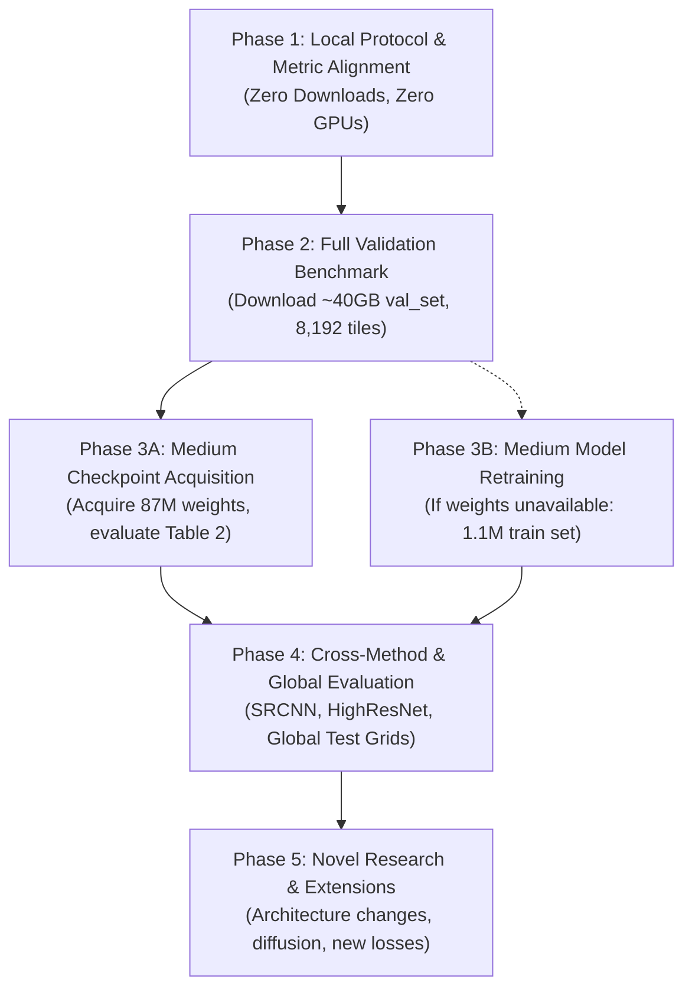

# Satlas-SR Reproduction Roadmap & Execution Strategy

- **Document Version**: `v1.0`
- **Date**: 2026-10-22
- **Author**: Senior Research Engineer
- **Target Paper**: *Zooming Out on Zooming In: Advancing Super-Resolution for Remote Sensing* ([arXiv:2311.18082](https://arxiv.org/abs/2311.18082))
- **Current State**: Frozen Baseline v1 (`results/satlas_sr_baseline_freeze_v1/`), Completed EXP-001 (`results/satlas_sr_experiment_001/`), Paper Gap Matrix (`results/satlas_sr_experiment_002_paper_gap_analysis/`)
- **Output Artifact**: `results/satlas_sr_experiment_002_paper_gap_analysis/REPRODUCTION_ROADMAP.md`

---

## 1. Executive Strategy

The strategic principle governing this roadmap is: **Rigorous paper reproduction must precede novel modeling or architecture modifications**.

Our previous audits and experiments established:
1. **The Small Baseline is Frozen & Audited**: The released 16.71M-parameter ESRGAN checkpoint (`esrgan_8S2.pth`) is thoroughly verified on the 256-tile urban validation subset (`data/small_val_set`), reproducing all official metrics and deterministically logging inference outputs.
2. **Metric Sensitivity is Quantified (EXP-001)**: The official stride-2 cPSNR implementation was reproduced within $0.00005\text{ dB}$, and dense stride-1 search was empirically characterized ($+0.1232\text{ dB}$ mean gain).
3. **The Paper Reproduction Gap is Defined (EXP-002)**: The published Table 2 primary benchmark evaluates an **87M Medium ESRGAN** across nationwide, multi-biome test splits, not the 16.71M Small ESRGAN on 256 urban tiles.

This roadmap outlines a sequential, gated 4-phase plan to bridge the remaining gaps. Each phase defines explicit acceptance criteria, resource requirements, and risk mitigations.

---

## 2. Prerequisites & Resource Requirements

| Prerequisite Item | Description / Scope | Expected Data Size | Resolution Mode | User Approval Required? |
| :--- | :--- | :---: | :---: | :---: |
| **P1: Full Validation Benchmark (`val_set`)** | 8,192 image pairs across diverse US biomes (`super_resolution_val_set_2024-01-09.tar`) | ~35–45 GB | External Download (AllenAI R2 bucket or HuggingFace) | **Yes** (Prior to Phase 2) |
| **P2: Medium Model Checkpoint (`esrgan_medium.pth`)** | Pretrained weights for 87M generator (`esrgan_larger1`) evaluated in Table 2 | ~350 MB | Inquire with authors / AllenAI repo maintainer | **Yes** (Prior to Phase 3A) |
| **P3: LPIPS Agreement Conversion Spec** | Mathematical formulation or lookup calibration used in paper to convert raw LPIPS to preference agreement % | 0 MB (Code/text) | Extract from Supplementary Section A.1 or author contact | **No** (Local investigation / documentation) |
| **P4: Full Urban Training Dataset (`train_urban_set`)** | 1.1M training image pairs across USA cities (4-part 7z archive: parts 1–4) | ~200–250 GB | External Download (Only needed if retraining 87M from scratch) | **Yes** (Prior to Phase 3B) |
| **P5: Test Set Grids (`test_set`)** | Eight $16 \times 16$ tile grids from global regions (Bolivia, France, Japan, etc.) | ~5–8 GB | External Download | **Yes** (Prior to Phase 4) |

---

## 3. Phased Reproduction Plan

---

### Phase 1: Local Protocol & Metric Standardization (Immediate / Zero-Cost)
*Goal: Complete all local metric protocol alignments without downloading external data or launching long training runs.*

- **Scope & Actions**:
  1. **LPIPS Agreement Conversion**: Audit supplementary material Section A.1/A.3 to implement the exact function mapping raw LPIPS distance ($\approx 0.347$) to paper Table 2 preference agreement ($\approx 0.8406$).
  2. **Automated Benchmark Runner**: Construct a standalone benchmark script `scripts/evaluate_paper_benchmark.py` that processes any input tile directory and generates the exact Table 2 metric triple: `(cPSNR, LPIPS_agreement, CLIPScore)`.
  3. **Dual Metric Reporting Standard**: Mandate that all future reporting retains both official stride-2 cPSNR and EXP-001 dense cPSNR side-by-side to prevent silent protocol drift.
- **Acceptance Criteria**:
  - Script evaluates arbitrary datasets in batch mode.
  - Produces per-tile CSV and summary JSON matching the paper schema.
  - Zero modifications to baseline freeze files.
  - No external downloads or GPU training required.

---

### Phase 2: Full Validation Benchmark Evaluation (Scaling Data Scope)
*Goal: Eliminate geographic and urban subset bias by evaluating the frozen small model on the full 8,192-tile validation set.*

- **Scope & Actions**:
  1. **User Approval & Download**: Obtain user permission to download `super_resolution_val_set_2024-01-09.tar` (~40 GB) to `../data/val_set`.
  2. **Data Integrity & Verification**: Extract archive, verify 8,192 tile pairs, check S2/NAIP image dimensions and band alignments.
  3. **Batch Inference Execution**: Run `run_full_validation_inference.py` across all 8,192 tiles using the frozen `esrgan_8S2.pth` checkpoint under deterministic tile ordering and seed 0.
  4. **Full Benchmark Evaluation**: Compute cPSNR (stride 2 & dense), LPIPS, CLIPScore, PSNR, and SSIM across all 8,192 tiles.
  5. **Stratified Biome Analysis**: Group tiles into urban, agricultural, forest, and arid biomes; quantify performance variance across geographic regions.
- **Acceptance Criteria**:
  - Exactly 8,192 tiles evaluated with atomic manifest.
  - Verified benchmark statistics with 95% bootstrap confidence intervals.
  - Direct comparison between 256 urban subset and full 8,192 nationwide set.

---

### Phase 3: Model Capacity Reconciliation (Matching 87M Table 2 Baseline)
*Goal: Evaluate the 87M Medium ESRGAN to reproduce Table 2's primary paper numbers.*

#### Path 3A: Acquire Pretrained Medium Checkpoint (Preferred / Low-Compute)
- **Scope & Actions**:
  1. Contact AllenAI paper maintainers (`piperw@allenai.org`) or inspect public HuggingFace model repositories for published `esrgan_larger1` weights (~350 MB).
  2. Verify checkpoint SHA-256 and confirm strict parameter match with `SSR_RRDBNet(num_feat=128, num_grow_ch=64, num_block=23)` (66.8M generator parameters).
  3. Run inference and evaluation on the 8,192 validation benchmark.
  4. Compare empirical scores directly to Table 2: cPSNR ($22.65\text{ dB}$ target) and CLIPScore ($0.8745$ target).
- **Acceptance Criteria**:
  - Recomputed cPSNR within $\pm 0.35\text{ dB}$ of published $22.6506\text{ dB}$.
  - Recomputed CLIPScore within $\pm 0.02$ of published $0.8745$.

#### Path 3B: Retrain Medium Model from Scratch (Fallback / High-Compute)
- **Prerequisites**: User approval for `train_urban_set` download (~200 GB) and multi-day GPU training budget.
- **Scope & Actions**:
  1. Download and extract 4-part 7z archive of `train_urban_set`.
  2. Configure `ssr/options/experiments/esrgan_larger1.yml` for local environment.
  3. Execute multi-GPU / single-GPU distributed training using Adam, L1 loss, VGG perceptual loss, and UNet discriminator.
  4. Save periodic checkpoints and validation snapshots.

---

### Phase 4: Cross-Method Baselines & Global Evaluation (Completing Paper Scope)
*Goal: Reproduce comparative baselines (SRCNN, HighResNet) and global test set grids.*

- **Scope & Actions**:
  1. **SRCNN & HighResNet Weights**: Download the official published weights (`srcnn_s2naip.pth` and `highresnet_s2naip.pth`, <50 MB each, referenced in `README.md`).
  2. **Comparative Benchmark**: Evaluate SRCNN and HighResNet on the same 8,192 validation tiles.
  3. **Table 2 Reconciliation**: Compare all 3 methods side-by-side to reproduce the published ranking:
     $$\text{ESRGAN} > \text{HighResNet} > \text{SRCNN}$$
  4. **Global Test Set Grids**: Evaluate models on the eight $16 \times 16$ tile grids (Bolivia, France, Japan, etc.) using `ssr/infer_grid.py`.
- **Acceptance Criteria**:
  - Published ranking and metric margins successfully reproduced.
  - Mosaic stitching verified on international test regions.

---

### Phase 5: Novel Research & Extensions (Future Work)
*Strict Rule: Phase 5 activities must NOT commence until Phases 1–3 are fully satisfied and documented.*

1. **Diffusion Model Comparisons**: Implement or benchmark modern diffusion pipelines against GAN outputs.
2. **Auxiliary Loss Exploration**: Train with CLIPScore auxiliary loss (Section 6.1) to replicate the 0.959 best model.
3. **Sub-Pixel Spatial Registration**: Integrate differentiable optical flow or spatial transformer networks to resolve true sub-pixel physical displacement.

---

## 4. Priority Recommendation for Immediate Action

The highest-priority, zero-risk next step is:
**Complete Phase 1 (Local Protocol & Metric Standardization)**:
- Establish the exact LPIPS agreement conversion function from paper supplementary notes.
- Build the automated Table 2 benchmark evaluation utility.
- Retain all frozen baseline assets completely intact.
- **Do not download large datasets or launch training until user provides explicit instruction.**
